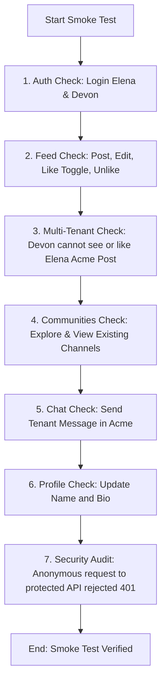

# Syncly Cycle 7.0 — Post-Deployment Production Smoke Test Plan

**Target Production URL:** https://syncly-app.vercel.app  
**Target Release:** v0.1.0  
**Verification Method:** Real Browser / Production API Verification  
**Accounts:** Authorized Production Staging Personas  

---

## 1. Test Execution Protocol

Upon confirmation of production deployment, the operator or automated test runner will execute these non-destructive tests against `https://syncly-app.vercel.app`:

---

## 2. Verification Checklist

### 2.1 Authentication & Session
- [ ] Access `https://syncly-app.vercel.app/login`. Confirm HTTP 200, no JS errors.
- [ ] Authenticate as Elena (`elena.rostova@acmecorp.com`). Confirm redirect to `/feed`.
- [ ] Refresh `/feed`. Confirm session persists without unexpected logout.
- [ ] Authenticate in a secondary session as Devon (`devon.thorne@globextech.com`).

### 2.2 Feed & Reactions
- [ ] Elena publishes a test announcement in Acme Corporation.
- [ ] Elena clicks "Like". Verify count updates to 1, heart icon fills.
- [ ] Marcus views the same post. Verify Marcus sees count = 1, heart icon unfilled (`hasLiked: false`).
- [ ] Elena clicks "Unlike". Verify count drops to 0.
- [ ] Elena edits post title/content. Confirm edit persists after page refresh.
- [ ] Confirm Devon (Globex) cannot view Elena's post via API or feed.

### 2.3 Communities & Workspaces
- [ ] Navigate to `/communities/explore`. Verify workspaces list without crash.
- [ ] Open workspace switcher in top navigation. Verify Elena can switch between authorized tenants.
- [ ] Verify unauthorized workspace access returns 403 or redirects.

### 2.4 Chat & Channels
- [ ] Access `/chat`. Verify Elena's Acme channels (`general`, `announcements`, `engineering`, etc.) appear.
- [ ] Send message in `general`. Confirm immediate delivery.
- [ ] Verify Devon cannot see Acme channel messages.

### 2.5 Profiles
- [ ] Access `/profile`.
- [ ] Update display name and bio. Save and refresh. Confirm persistence.
- [ ] Verify no role escalation inputs are visible or accepted.

### 2.6 Security Boundaries & Fail-Closed Guardrails
- [ ] Execute `curl -i https://syncly-app.vercel.app/api/posts`. Confirm `HTTP 401 Unauthorized`.
- [ ] Execute `curl -i https://syncly-app.vercel.app/api/communities/create`. Confirm `HTTP 401 Unauthorized`.
- [ ] Confirm zero service-role keys or sensitive environment variables leak in client-side HTML or JS bundles.

---

## 3. Results Recording Template

| Section | Check | Target | Production Result | Operator Signature |
| :--- | :--- | :--- | :--- | :--- |
| **Auth** | Login / Session Refresh | `/login`, `/feed` | Pending Deployment | |
| **Feed** | Create / Edit / Delete Post | `/feed`, `/api/posts` | Pending Deployment | |
| **Reactions** | Like / Unlike / Idempotency | `/api/posts/[id]/like`| Pending Deployment | |
| **Tenancy** | Cross-tenant RLS Boundary | `/api/posts` | Pending Deployment | |
| **Chat** | Channel Message Delivery | `/chat` | Pending Deployment | |
| **Profile** | Name & Bio Updates | `/profile` | Pending Deployment | |
| **Security**| Unauthenticated 401s | Protected APIs | Pending Deployment | |

**Status:** Awaiting Production Deployment Approval.
