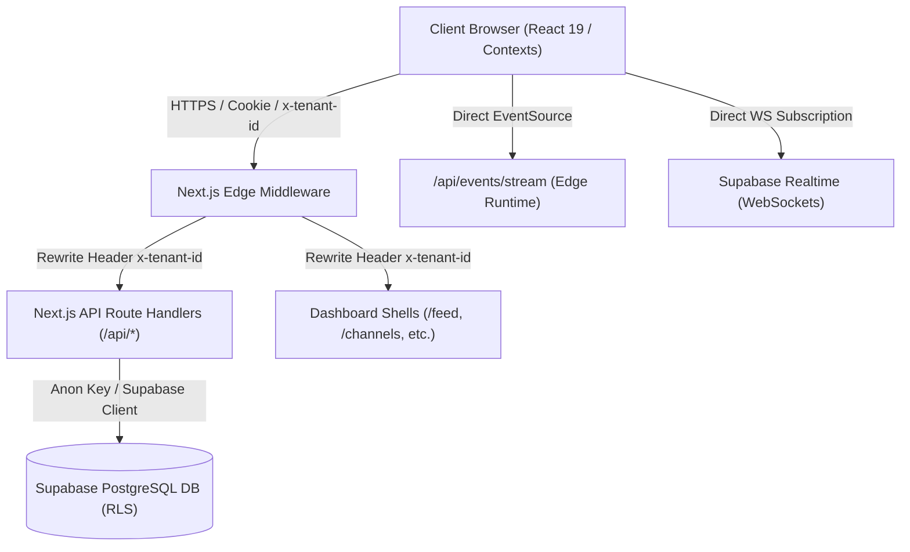

# SECURITY ARCHITECTURE AUDIT: SYNCLY PLATFORM

**Target Application**: Syncly (Multi-Tenant Corporate Platform)  
**Repository**: `https://github.com/swastikdas18-ui/Syncly.app.git`  
**Framework**: Next.js 16 App Router (Turbopack)  
**Database**: Supabase PostgreSQL + Row-Level Security (RLS)  
**Realtime**: Supabase Realtime & Edge SSE (`/api/events/stream`)  
**Storage**: Supabase Storage (`community-media`)  
**Date**: November 2026  
**Auditor**: Principal Application Security Engineer & PostgreSQL Architect  

---

## 1. Executive Architecture Summary

Syncly is a multi-tenant corporate communication and engagement platform providing real-time team chats, announcement feeds, events management, and corporate workspace discovery.

### 1.1 Architectural Topology
- **Edge Routing / Ingress**: Next.js Edge Middleware (`middleware.ts`). Inspects cookies (`syncly_session`, `active_tenant_id`) and injects tenant headers (`x-tenant-id`).
- **Application Server**: Next.js 16 App Router with Node.js and Edge Route Handlers.
- **Client State**: Dual React Contexts (`AuthContext.tsx` and `WorkspaceContext.tsx`) with localStorage mirror and broadcast event bus.
- **Persistence Layer**: PostgreSQL database managed via Supabase with RLS enabled on core tables.
- **Realtime Layer**: Server-Sent Events (`/api/events/stream`) on Next.js Edge runtime, supplemented by Supabase Realtime presence and table publications.



---

## 2. Authentication Trust Boundaries

### 2.1 Identity Lifecycles & Token Flow
1. **Production Supabase Auth**:
   - Client authenticates via Supabase Auth (`supabase.auth.signInWithPassword`), obtaining JWT access and refresh tokens.
   - Handled via `sb-access-token` cookie or localStorage session persistence.
2. **Demo Persona Authentication**:
   - `handleDemoLogin` in `app/(auth)/login/page.tsx` generates an in-memory session payload for `Demo Intern` or `Demo Mentor`.
   - Serialized into cookie `syncly_session` and mirrored into `localStorage.setItem('syncly_user', ...)`.
   - **Critical Boundary Vulnerability (CRIT-01)**: The `syncly_session` cookie is created client-side in plaintext JSON format with no HMAC or asymmetric cryptographic signature. Any client or attacker can set `document.cookie = "syncly_session=..."` with arbitrary `user.id`, `user.role: 'owner'`, and arbitrary `tenant_id`, bypassing server-side authentication in Edge middleware.

### 2.2 Workspace Identity & Context Derivation
- Server-side context is extracted in `lib/tenant/context.ts` via `getTenantContext()`:
  - Reads `headers().get('x-tenant-id')`.
  - Validates RFC 4122 UUID syntax to prevent PostgreSQL `22P02` cast crashes.
  - Falls back to `DEFAULT_TENANT_ID` (`00000000-0000-0000-0000-000000000001`).
- **Critical Boundary Vulnerability (CRIT-02)**: In `middleware.ts`, `candidateTenant` is taken from `request.headers.get('x-tenant-id')` or `request.cookies.get('active_tenant_id')`. An authenticated member of Tenant B can simply pass `x-tenant-id: <Tenant_A_UUID>` to fool API route handlers into believing they are operating in Tenant A.

---

## 3. Database Access Patterns & RLS Verification

### 3.1 Session Variable Anti-Pattern (`app.current_tenant_id`)
In `supabase/migrations/final_production_schema.sql`:
```sql
CREATE OR REPLACE FUNCTION public.get_current_tenant_id()
RETURNS UUID AS $$ 
  SELECT NULLIF(current_setting('app.current_tenant_id', true), '')::uuid; 
$$ LANGUAGE sql STABLE;

CREATE POLICY tenant_isolation_posts_select ON public.posts
  FOR SELECT USING (
    tenant_id = public.get_current_tenant_id() OR public.get_current_tenant_id() IS NULL
  );
```
### Key Structural Vulnerabilities:
1. **RLS Open-Door Bypass**: The clause `OR public.get_current_tenant_id() IS NULL` causes the RLS policy to evaluate to `TRUE` if `app.current_tenant_id` has not been set by a prior SQL statement! When Supabase anon/authenticated client executes queries without running `SET LOCAL app.current_tenant_id = '...'`, all records across all tenants are returned.
2. **Connection Pooling Leakage (PgBouncer)**: Transaction-scoped settings (`SET LOCAL`) are safe only within an explicit transaction. If standard `SET app.current_tenant_id` is executed on pooled connections, subsequent queries on the same connection reuse the previous tenant's identity.
3. **No Database-Level Membership Join**: Standard best-practice PostgreSQL RLS relies on:
   ```sql
   tenant_id IN (
     SELECT community_id FROM public.memberships WHERE user_id = auth.uid()
   )
   ```
   Relying on a mutable setting decoupled from `auth.uid()` exposes queries to forgery.

---

## 4. Complete API Route Inventory & Attack Surface

| Endpoint | Method | Runtime | Auth Source | Vulnerabilities Identified |
| :--- | :--- | :--- | :--- | :--- |
| `/api/auth/login` | POST | Node | Supabase Auth | Safe fallback, credential validation |
| `/api/channels` | GET, POST | Node | Header `x-tenant-id` | **HIGH**: Trusting header without membership verification |
| `/api/channels/[id]/messages` | GET, POST | Node | Header `x-tenant-id` | **CRITICAL**: Cross-tenant chat reading/posting via forged header |
| `/api/communities/create` | POST | Node | Header `x-tenant-id` | Arbitrary community creation; unchecked owner assignment |
| `/api/communities/explore` | GET | Node | Unauthenticated | Public directory; check for sensitive field leaks |
| `/api/communities/[id]/join` | POST | Node | Body/Header | Self-join authorization logic check |
| `/api/communities/[id]/requests` | GET | Node | Header `x-tenant-id` | **HIGH**: Request review accessible across tenants |
| `/api/events` | GET, POST | Node | Header `x-tenant-id` | **HIGH**: Cross-tenant event scheduling and viewing |
| `/api/events/stream` | GET | Edge | Query param `tenantId` | **CRITICAL**: Any user can connect to any tenant's SSE stream |
| `/api/media/upload` | POST | Node | Header `x-tenant-id` | **HIGH**: Folder partitioning spoofable via forged header |
| `/api/memberships` | GET | Node | Header `x-tenant-id` | Membership enumeration |
| `/api/memberships/batch-join` | POST | Node | Body array | Mass enrollment validation |
| `/api/notifications` | GET | Node | Header `x-tenant-id` | Tenant notification leakage |
| `/api/posts` | GET, POST | Node | Header `x-tenant-id` | **CRITICAL**: Seed/in-memory posts or DB posts readable cross-tenant |
| `/api/presence` | GET, POST | Node | Query / Body | Presence status spoofing |
| `/api/presence/track` | POST, GET | Node | Header `x-tenant-id` | Anonymous presence tracking |
| `/api/profile` | GET, PATCH | Node | Header `x-tenant-id` | **CRITICAL**: Privilege escalation (`role: owner`) via self-update |
| `/api/tenant/members` | GET | Node | Header `x-tenant-id` | Directory harvesting |
| `/api/tenant/onboarding` | POST | Node | Header `x-tenant-id` | Self-provisioning validation |
| `/api/tenants` | GET | Node | Header `x-tenant-id` | Tenant listing |
| `/api/verify-isolation` | GET | Node | Query param | Diagnostic utility; safe mock |

---

## 5. Storage & Realtime Attack Surfaces

### 5.1 Storage (`community-media`)
- Route: `/api/media/upload` partitions by `${tenantId}/posts/${uuid}_${sanitized}`.
- Because `tenantId` is derived from `getTenantContext()` (which reads `x-tenant-id`), an attacker can upload files directly into another tenant's storage path.
- Public URL generated directly without signed URL validation or bucket read-authorization policy.

### 5.2 Realtime & SSE Stream (`/api/events/stream`)
- Configured with `runtime = 'edge'` and accepts `?tenantId=...`.
- Handshake returns `{ tenantId, status: 'ok' }`.
- No session token verification on connection; any unauthenticated client can open an EventSource connection to any tenant UUID and receive heartbeats and broadcasts.

---

## 6. Initial Vulnerability Classification

| ID | Severity | Finding | Root Cause |
| :--- | :--- | :--- | :--- |
| **SEC-CRIT-01** | **Critical** | Client-Forged `syncly_session` Cookie | Plaintext unsigned JSON cookie trusted by Edge middleware for authentication. |
| **SEC-CRIT-02** | **Critical** | Missing Server-Side Membership Verification on Tenant Switching | Middleware & API trust `x-tenant-id` and `active_tenant_id` without verifying `memberships` table. |
| **SEC-CRIT-03** | **Critical** | Open-Door RLS Fallback (`OR app.current_tenant_id IS NULL`) | Database queries without explicit session initialization bypass RLS entirely. |
| **SEC-CRIT-04** | **Critical** | Privilege Escalation in Profile Updates | Users can PATCH `/api/profile` with `{ role: 'owner' }` and promote themselves. |
| **SEC-HIGH-01** | **High** | Unauthenticated & Cross-Tenant Realtime SSE Stream | `/api/events/stream` connects without validating tenant membership of the requesting user. |
| **SEC-HIGH-02** | **High** | Storage Folder Partitioning Forgery | `/api/media/upload` trusts client tenant context to decide destination storage path. |
| **SEC-HIGH-03** | **High** | Cross-Tenant Channel Message Creation & Reading | `/api/channels/[channelId]/messages` accepts any channelId under tenant without verifying user membership. |

---

## 7. Next Steps & Phase Progression

Phase 1 discovery is complete. Proceed to **Phase 2 (PostgreSQL & RLS Audit)** and **Phase 3 (Authentication & RBAC Audit)** to generate comprehensive audit reports and safe remediation scripts.

