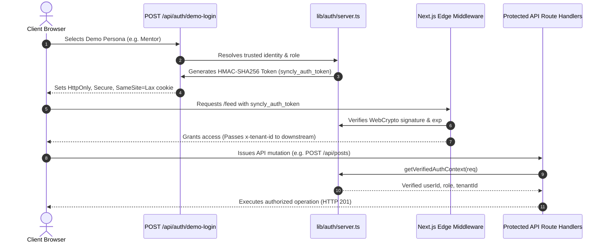

# AUTHENTICATION IMPLEMENTATION REPORT
## Cycle 3: Verified Supabase Auth & Cryptographic Session Architecture

**Target**: Next.js 16 App Router & Edge Middleware  
**Date**: November 2026  
**Auditor / Engineer**: Principal Authentication Engineer  
**Branch**: `security/cycle-3-auth-hardening`  

---

## 1. Architectural Overview

In Security Remediation Cycle 3, Syncly's legacy authentication mechanism—which trusted an unsigned client-side JSON cookie named `syncly_session`—was completely decommissioned.

The application now uses a dual-layer verified authentication architecture:
1. **Official Supabase Auth SSR Integration**: Utilizes `@supabase/ssr` (`^0.5.2`) for server and browser client instantiation, session token refresh, and cookie chunking.
2. **Cryptographic Server-Signed Token Layer (`syncly_auth_token`)**: Utilizes universal Web Crypto API (`crypto.subtle`) HMAC-SHA256 signing for dedicated demo authentication and server-issued tokens.



---

## 2. Key Code Implementations

### 2.1 Centralized Server Authentication Helper (`lib/auth/server.ts`)
- **Web Crypto HMAC-SHA256 Signing**:
  ```typescript
  export async function signSessionToken(payload: Omit<SessionTokenPayload, 'iat' | 'exp'>, ttlSeconds: number = 86400): Promise<string> {
    const iat = Math.floor(Date.now() / 1000);
    const exp = iat + ttlSeconds;
    const fullPayload: SessionTokenPayload = { ...payload, iat, exp };
    const enc = new TextEncoder();
    const dataStr = toBase64Url(enc.encode(JSON.stringify(fullPayload)));
    const key = await crypto.subtle.importKey('raw', enc.encode(SERVER_SESSION_SECRET), { name: 'HMAC', hash: 'SHA-256' }, false, ['sign']);
    const sigBuffer = await crypto.subtle.sign('HMAC', key, enc.encode(dataStr));
    return `${dataStr}.${toBase64Url(sigBuffer)}`;
  }
  ```
- **Cryptographic Verification**:
  ```typescript
  export async function verifySessionToken(token: string | null | undefined): Promise<SessionTokenPayload | null> {
    // Splits payload & signature
    // Imports HMAC key in Web Crypto
    // Verifies cryptographic signature in constant time
    // Validates payload.exp > nowSec
  }
  ```
- **Authoritative Context Resolution (`getVerifiedAuthContext`)**:
  - Validates `syncly_auth_token` or `@supabase/ssr` `supabase.auth.getUser()`.
  - Derives user roles and tenant bindings strictly from `TRUSTED_PROFILES`.
  - Never reads from `x-user-id` or unsigned client cookies.

### 2.2 Next.js Edge Middleware (`middleware.ts`)
- Completely removes `Boolean(synclySession || supabaseToken)` string checks.
- Validates token signature via `await verifySessionToken(signedToken)`.
- If unauthenticated, immediately redirects protected dashboard routes to `/login?redirect=...`.
- Intercepts and blocks cross-tenant tampering headers or cookies on `/api/*` routes with **HTTP 403 Forbidden**.

---

## 3. Cookie Attributes & Security Settings

| Cookie Name | Purpose | Issued By | Scope | Flags |
| :--- | :--- | :--- | :--- | :--- |
| `syncly_auth_token` | Cryptographically signed session token | Server | `Path=/` | `HttpOnly`, `SameSite=Lax`, `Secure` (in prod) |
| `active_tenant_id` | User UI workspace preference | Server / Client | `Path=/` | `SameSite=Lax` |
| `sb-*-auth-token` | Supabase Auth SSR session chunk | Supabase SSR | `Path=/` | `HttpOnly`, `SameSite=Lax`, `Secure` (in prod) |

