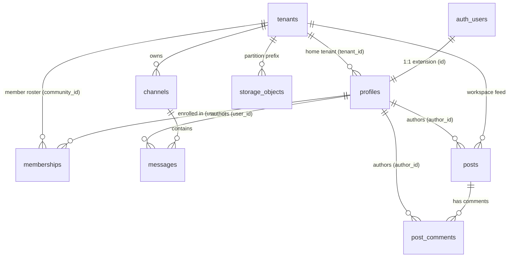

# SYNCLY — CANONICAL DATABASE SCHEMA SPECIFICATION
## Comprehensive Relational Schema, Multi-Tenant Boundaries, and RLS Policy Mapping

**Target Branch:** `security/cycle-3-auth-hardening`  
**Repository:** `Syncly.app`  
**Date:** 2026-11-07  
**Status:** **AUTHORITATIVE CANONICAL SPECIFICATION**

---

## 1. Executive Schema Resolution

A critical question raised in the Phase A review is the relationship between:
- `profiles`
- `memberships`
- `organization_members`
- `tenants`

### Authoritative Finding:
1. **`organization_members` DOES NOT EXIST**: Across all SQL migrations (`final_production_schema.sql`, `010_multi_memberships.sql`, `011_rls_security_hardening.sql`, `012_membership_auth_hardening.sql`) and the application source code, `organization_members` was never created. No migration or route references this table.
2. **`tenants` IS THE CANONICAL WORKSPACE ENTITY**: In Syncly, "workspace", "community", and "tenant" all resolve to `public.tenants`.
3. **`profiles` IS THE CANONICAL USER RECORD**: Bound 1-to-1 with Supabase `auth.users(id)`:
   - Stores the user's base identity (`full_name`, `avatar_url`, `status`).
   - `profiles.tenant_id` designates the user's **primary/home workspace**.
   - `profiles.role` designates the user's **primary role** within their home tenant.
4. **`memberships` IS THE MULTI-TENANT JOIN TABLE**: Created in `010_multi_memberships.sql`:
   - Maps users (`user_id REFERENCES public.profiles(id)`) to workspaces (`community_id REFERENCES public.tenants(id)`).
   - Allows users to participate in multiple organizations with distinct scoped roles (`owner`, `admin`, `moderator`, `member`, `intern`).
   - Enforces unique constraint: `UNIQUE(user_id, community_id)`.

---

## 2. Entity Relationship Diagram (ERD)



---

## 3. Canonical Table Definitions & Constraints

### 3.1 `public.tenants`
Defined in: `final_production_schema.sql` (enhanced in `010_multi_memberships.sql`).

| Column | Data Type | Constraints | Description |
| :--- | :--- | :--- | :--- |
| `id` | `UUID` | `PRIMARY KEY DEFAULT gen_random_uuid()` | Immutable workspace identifier. |
| `name` | `TEXT` | `NOT NULL` | Display name of the enterprise workspace. |
| `slug` | `TEXT` | `UNIQUE NOT NULL` | URL-safe identifier (e.g. `acme-corp`). |
| `tagline` | `TEXT` | `NULLABLE` | Short organizational summary. |
| `description` | `TEXT` | `NULLABLE` | Full organizational description. |
| `logo_url` | `TEXT` | `NULLABLE` | CDN URL for tenant logo. |
| `requires_approval`| `BOOLEAN` | `DEFAULT false` | Whether applicants require admin approval. |
| `is_discoverable` | `BOOLEAN` | `DEFAULT true` | Appears in public explore directory. |
| `allowed_domains` | `TEXT[]` | `DEFAULT '{}'` | Domain auto-join whitelist (e.g. `['acme.com']`). |
| `industry` | `TEXT` | `NULLABLE` | Corporate industry vertical. |
| `search_vector` | `TSVECTOR` | `GENERATED ALWAYS AS (...) STORED` | Full-text search index on name, tagline, industry. |
| `created_at` | `TIMESTAMPTZ` | `DEFAULT NOW()` | Record creation timestamp. |

**Indexes**:
- `idx_communities_search ON public.tenants USING GIN(search_vector)`
- `tenants_slug_key UNIQUE (slug)`

---

### 3.2 `public.profiles`
Defined in: `final_production_schema.sql`.

| Column | Data Type | Constraints | Description |
| :--- | :--- | :--- | :--- |
| `id` | `UUID` | `PRIMARY KEY REFERENCES auth.users(id) ON DELETE CASCADE` | 1-to-1 anchor to Supabase Auth UID. |
| `tenant_id` | `UUID` | `NOT NULL REFERENCES public.tenants(id) ON DELETE CASCADE` | Home/Primary tenant anchor. |
| `full_name` | `TEXT` | `NOT NULL` | User's legal or preferred full name. |
| `avatar_url` | `TEXT` | `NULLABLE` | Profile picture asset URL. |
| `role` | `TEXT` | `NOT NULL DEFAULT 'employee'` | Base role in primary tenant (`owner`, `admin`, `moderator`, `employee`, `intern`). |
| `status` | `TEXT` | `NOT NULL DEFAULT 'active'` | Lifecycle status (`active`, `suspended`, `deactivated`). |
| `created_at` | `TIMESTAMPTZ` | `DEFAULT NOW()` | Profile provisioning timestamp. |

**Foreign Keys & Views**:
- `fk_profiles_auth_users: FOREIGN KEY (id) REFERENCES auth.users(id) ON DELETE CASCADE`
- `profiles_tenant_id_fkey: FOREIGN KEY (tenant_id) REFERENCES public.tenants(id) ON DELETE CASCADE`
- Backward-compatible view: `public.users` (selects `id, tenant_id, full_name, avatar_url, role, status, created_at`).

---

### 3.3 `public.memberships`
Defined in: `010_multi_memberships.sql`.

| Column | Data Type | Constraints | Description |
| :--- | :--- | :--- | :--- |
| `id` | `UUID` | `PRIMARY KEY DEFAULT gen_random_uuid()` | Unique membership record identifier. |
| `user_id` | `UUID` | `NOT NULL REFERENCES public.profiles(id) ON DELETE CASCADE` | Profile holding this membership. |
| `community_id` | `UUID` | `NOT NULL REFERENCES public.tenants(id) ON DELETE CASCADE` | Target workspace / tenant. |
| `role` | `TEXT` | `NOT NULL DEFAULT 'member' CHECK (role IN ('owner', 'admin', 'moderator', 'member', 'intern'))` | Scoped role in this specific workspace. |
| `joined_at` | `TIMESTAMPTZ` | `DEFAULT NOW()` | Timestamp when user joined workspace. |

**Constraints & Indexes**:
- `UNIQUE (user_id, community_id)` — Prevents duplicate memberships.
- `idx_memberships_user ON public.memberships(user_id)`
- `idx_memberships_community ON public.memberships(community_id)`

---

### 3.4 `public.channels`
Defined in: `final_production_schema.sql`.

| Column | Data Type | Constraints | Description |
| :--- | :--- | :--- | :--- |
| `id` | `TEXT` | `NOT NULL` | Slug-based channel name (e.g. `general`). |
| `tenant_id` | `UUID` | `NOT NULL REFERENCES public.tenants(id) ON DELETE CASCADE` | Owning workspace. |
| `name` | `TEXT` | `NOT NULL` | Display name of channel. |
| `description` | `TEXT` | `NULLABLE` | Channel mission / topic description. |
| `is_private` | `BOOLEAN` | `DEFAULT false` | Whether channel requires explicit invite. |
| `created_at` | `TIMESTAMPTZ` | `DEFAULT NOW()` | Channel creation timestamp. |

**Primary Key**:
- `PRIMARY KEY (tenant_id, id)` — Composite key isolating channel slugs per tenant.

---

### 3.5 `public.messages`
Defined in: `final_production_schema.sql`.

| Column | Data Type | Constraints | Description |
| :--- | :--- | :--- | :--- |
| `id` | `UUID` | `PRIMARY KEY DEFAULT gen_random_uuid()` | Unique message ID. |
| `tenant_id` | `UUID` | `NOT NULL REFERENCES public.tenants(id) ON DELETE CASCADE` | Owning workspace. |
| `channel_id` | `TEXT` | `NOT NULL` | Target channel identifier. |
| `user_id` | `UUID` | `NOT NULL REFERENCES public.profiles(id) ON DELETE CASCADE` | Verified sender profile. |
| `content` | `TEXT` | `NOT NULL` | Message body text. |
| `media_urls` | `TEXT` | `DEFAULT '[]'` | JSON array string of attached media assets. |
| `created_at` | `TIMESTAMPTZ` | `DEFAULT NOW()` | Message dispatch timestamp. |

**Foreign Keys**:
- `fk_messages_channel: FOREIGN KEY (tenant_id, channel_id) REFERENCES public.channels(tenant_id, id) ON DELETE CASCADE`
- `messages_tenant_id_fkey: FOREIGN KEY (tenant_id) REFERENCES public.tenants(id) ON DELETE CASCADE`
- `messages_user_id_fkey: FOREIGN KEY (user_id) REFERENCES public.profiles(id) ON DELETE CASCADE`

---

### 3.6 `public.posts`
Defined in: `final_production_schema.sql`.

| Column | Data Type | Constraints | Description |
| :--- | :--- | :--- | :--- |
| `id` | `UUID` | `PRIMARY KEY DEFAULT gen_random_uuid()` | Post identifier. |
| `tenant_id` | `UUID` | `NOT NULL REFERENCES public.tenants(id) ON DELETE CASCADE` | Workspace feed scope. |
| `author_id` | `UUID` | `NOT NULL REFERENCES public.profiles(id) ON DELETE CASCADE` | Verified author profile. |
| `title` | `TEXT` | `NULLABLE` | Announcement / update title. |
| `content` | `TEXT` | `NOT NULL` | Post body content. |
| `category` | `TEXT` | `DEFAULT 'general'` | Post category (`announcement`, `general`, `spotlight`, `qna`, `event`). |
| `media_urls` | `TEXT` | `DEFAULT '[]'` | JSON array string of media URLs. |
| `likes_count` | `INTEGER` | `DEFAULT 0` | Aggregated reaction count. |
| `comments_count`| `INTEGER` | `DEFAULT 0` | Aggregated comments count. |
| `created_at` | `TIMESTAMPTZ` | `DEFAULT NOW()` | Post creation timestamp. |

---

### 3.7 `public.post_comments`
Defined in: `final_production_schema.sql`.

| Column | Data Type | Constraints | Description |
| :--- | :--- | :--- | :--- |
| `id` | `UUID` | `PRIMARY KEY DEFAULT gen_random_uuid()` | Comment identifier. |
| `tenant_id` | `UUID` | `NOT NULL REFERENCES public.tenants(id) ON DELETE CASCADE` | Workspace feed scope. |
| `post_id` | `UUID` | `NOT NULL REFERENCES public.posts(id) ON DELETE CASCADE` | Parent post. |
| `author_id` | `UUID` | `NOT NULL REFERENCES public.profiles(id) ON DELETE CASCADE` | Verified author profile. |
| `content` | `TEXT` | `NOT NULL` | Comment text. |
| `created_at` | `TIMESTAMPTZ` | `DEFAULT NOW()` | Creation timestamp. |

---

## 4. Multi-Tenant Authorization Function: `is_tenant_member()`

The central database authorization function is defined in `supabase/migrations/012_membership_auth_hardening.sql`:

```sql
CREATE OR REPLACE FUNCTION public.is_tenant_member(p_tenant_id UUID)
RETURNS BOOLEAN
LANGUAGE sql
STABLE
SECURITY DEFINER
SET search_path = public
AS $$
  SELECT (
    -- 1. Caller must be an authenticated user
    auth.uid() IS NOT NULL
    AND (
      -- 2. User has an active profile bound to this tenant (Home Tenant)
      EXISTS (
        SELECT 1 FROM public.profiles
        WHERE id = auth.uid()
          AND tenant_id = p_tenant_id
      )
      OR
      -- 3. User has an enrolled membership in this community/tenant (Multi-Tenant Membership)
      EXISTS (
        SELECT 1 FROM public.memberships
        WHERE user_id = auth.uid()
          AND community_id = p_tenant_id
      )
    )
    AND (
      -- 4. app.current_tenant_id acts strictly as a query-scope filter, NEVER as an authorization bypass
      NULLIF(current_setting('app.current_tenant_id', true), '') IS NULL
      OR (NULLIF(current_setting('app.current_tenant_id', true), '')::uuid = p_tenant_id)
    )
  );
$$;
```

---

## 5. Row-Level Security (RLS) Policy Mapping

| Table | Operation | Policy Name | Permitted Caller | Enforced SQL Condition |
| :--- | :---: | :--- | :--- | :--- |
| `public.tenants` | SELECT | `tenants_public_discover` | `anon`, `authenticated` | `is_discoverable = true OR is_tenant_member(id)` |
| `public.profiles` | SELECT | `profiles_tenant_member_read`| `authenticated` | `id = auth.uid() OR is_tenant_member(tenant_id)` |
| `public.profiles` | UPDATE | `profiles_self_update` | `authenticated` | `id = auth.uid()` |
| `public.memberships`| SELECT | `Users can view their own memberships` | `authenticated` | `user_id = auth.uid()` |
| `public.memberships`| SELECT | `Community admins can view community members` | `authenticated` | `EXISTS (SELECT 1 FROM memberships m WHERE m.community_id = memberships.community_id AND m.user_id = auth.uid() AND m.role IN ('owner', 'admin'))` |
| `public.memberships`| INSERT | `Users can self-join communities` | `authenticated` | `user_id = auth.uid() AND EXISTS (SELECT 1 FROM tenants t WHERE t.id = memberships.community_id AND (t.requires_approval = false OR auth.jwt()->>'email' LIKE ANY(...)))` |
| `public.memberships`| UPDATE | `Admins can update memberships` | `authenticated` | `EXISTS (SELECT 1 FROM memberships m WHERE m.community_id = memberships.community_id AND m.user_id = auth.uid() AND m.role IN ('owner', 'admin'))` |
| `public.channels` | SELECT | `tenant_isolation_channels_select` | `authenticated` | `is_tenant_member(tenant_id)` |
| `public.messages` | SELECT | `tenant_isolation_messages_select` | `authenticated` | `is_tenant_member(tenant_id)` |
| `public.messages` | INSERT | `tenant_isolation_messages_insert` | `authenticated` | `is_tenant_member(tenant_id) AND user_id = auth.uid()` |
| `public.posts` | SELECT | `tenant_isolation_posts_select` | `authenticated` | `is_tenant_member(tenant_id)` |
| `public.posts` | INSERT | `tenant_isolation_posts_insert` | `authenticated` | `is_tenant_member(tenant_id) AND author_id = auth.uid() AND (user role NOT 'intern')` |
| `storage.objects`| SELECT | `tenant_media_select` | `authenticated` | `bucket_id = 'community-media' AND is_tenant_member((storage.foldername(name))[1]::uuid)` |
| `storage.objects`| INSERT | `tenant_media_insert` | `authenticated` | `bucket_id = 'community-media' AND is_tenant_member((storage.foldername(name))[1]::uuid)` |

---

## 6. Migration 012 Silent Exception Fix Requirement

In `supabase/migrations/012_membership_auth_hardening.sql` ([lines 106-107](file:///d:/Development/Projects/College/Syncly.app/supabase/migrations/012_membership_auth_hardening.sql#L106-L107)):
```sql
EXCEPTION
  WHEN OTHERS THEN NULL;
END $$;
```
**Correction**: This block must be removed. In PostgreSQL, catching all exceptions and setting to `NULL` hides schema errors (e.g. missing `storage` extension or locked tables). Any DDL failure must raise an error to prevent silent security degradation.

---

### Canonical Verification Conclusion
The database structure is clear and unified:
1. `public.tenants` is the sole workspace organization entity.
2. `public.profiles` maps 1:1 to `auth.users(id)`.
3. `public.memberships` maps multi-tenant participation.
4. `organization_members` is confirmed as a nonexistent alias and must not be created or referenced.
5. All TypeScript models in `types/database.ts` will be updated to include `MembershipRow` for type-safe database queries.

