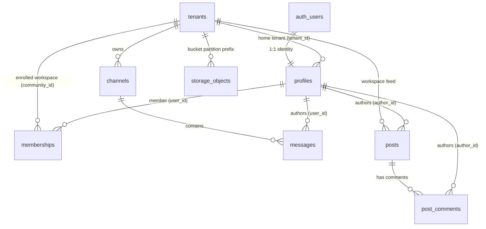
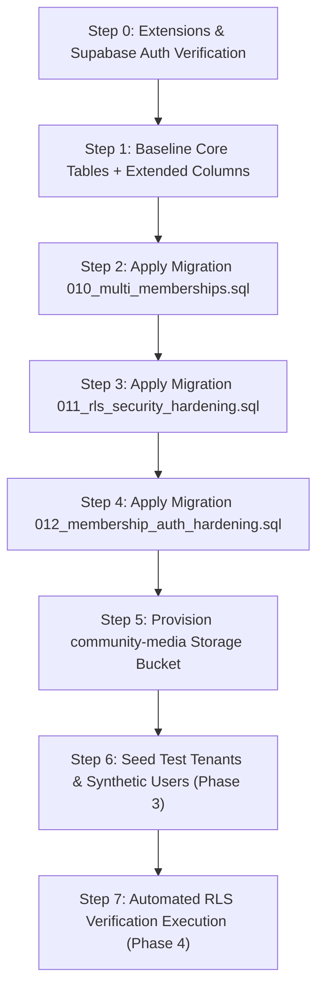

# SYNCLY — SECURITY CYCLE 4.2.2: BASELINE SCHEMA RECONSTRUCTION & STAGING MIGRATION PLAN

**Target Branch:** `security/cycle-3-auth-hardening`  
**Repository:** `Syncly.app`  
**Analysis Type:** Static Source & DDL Dependency Discovery (Pre-Execution)  
**Date:** 2026-11-07  
**Gate Status:** **APPROVED PLAN — READY FOR CREDENTIAL PROVISIONING**

---

## 1. Executive Summary & Source Discovery

This plan provides the complete baseline schema reconstruction and migration execution plan required to initialize a clean Supabase staging database before applying migrations `010`, `011`, and `012`.

A critical architectural flaw identified in earlier cycles was assuming that `supabase/migrations/final_production_schema.sql` could be executed directly as a baseline. Static AST inspection proves that **`final_production_schema.sql` cannot serve as an unassisted baseline in its current state** because:
1. It omits essential columns on `public.tenants` (`tagline`, `industry`, `requires_approval`, `allowed_domains`, `is_discoverable`), which causes migration `010` to immediately crash on full-text index creation.
2. It embeds the insecure `OR public.get_current_tenant_id() IS NULL` policy flaw (SEC-CRIT-03) across all core tables.
3. It installs an auth trigger with a hardcoded fallback tenant UUID (`00000000-0000-0000-0000-000000000001`).
4. It does not define the `community-media` storage bucket or multi-tenant membership structures.

This document reconstructs the corrected baseline schema, details the dependency hierarchy, and defines the exact commands to execute once staging credentials are provided.

---

## 2. Canonical Baseline Schema Specification

The baseline schema requires 6 core tables plus the multi-tenant join table, configured with all prerequisite columns:



### 2.1 Table Inventory & Column Requirements

#### 1. `public.tenants` (Base Workspace Entity)
- `id UUID PRIMARY KEY DEFAULT gen_random_uuid()`
- `name TEXT NOT NULL`
- `slug TEXT UNIQUE NOT NULL`
- `tagline TEXT` *(Prerequisite for 010 generated search_vector)*
- `industry TEXT` *(Prerequisite for 010 generated search_vector)*
- `description TEXT`
- `logo_url TEXT`
- `requires_approval BOOLEAN DEFAULT false` *(Prerequisite for 010 join policy)*
- `allowed_domains TEXT[] DEFAULT '{}'` *(Prerequisite for 010 domain validation)*
- `is_discoverable BOOLEAN DEFAULT true` *(Prerequisite for 011 select policy)*
- `created_at TIMESTAMPTZ DEFAULT NOW()`

#### 2. `public.profiles` (User Identity Anchor)
- `id UUID PRIMARY KEY REFERENCES auth.users(id) ON DELETE CASCADE`
- `tenant_id UUID NOT NULL REFERENCES public.tenants(id) ON DELETE CASCADE`
- `full_name TEXT NOT NULL`
- `avatar_url TEXT`
- `role TEXT NOT NULL DEFAULT 'employee'` *(Enum: owner, admin, moderator, employee, intern)*
- `status TEXT NOT NULL DEFAULT 'active'` *(Enum: active, suspended, deactivated)*
- `created_at TIMESTAMPTZ DEFAULT NOW()`

#### 3. `public.channels` (Chat Channels)
- `id TEXT NOT NULL`
- `tenant_id UUID NOT NULL REFERENCES public.tenants(id) ON DELETE CASCADE`
- `name TEXT NOT NULL`
- `description TEXT`
- `is_private BOOLEAN DEFAULT false`
- `created_at TIMESTAMPTZ DEFAULT NOW()`
- `PRIMARY KEY (tenant_id, id)`

#### 4. `public.messages` (Channel Messages)
- `id UUID PRIMARY KEY DEFAULT gen_random_uuid()`
- `tenant_id UUID NOT NULL REFERENCES public.tenants(id) ON DELETE CASCADE`
- `channel_id TEXT NOT NULL`
- `user_id UUID NOT NULL REFERENCES public.profiles(id) ON DELETE CASCADE`
- `content TEXT NOT NULL`
- `media_urls TEXT DEFAULT ''`
- `created_at TIMESTAMPTZ DEFAULT NOW()`
- `FOREIGN KEY (tenant_id, channel_id) REFERENCES public.channels(tenant_id, id) ON DELETE CASCADE`

#### 5. `public.posts` (Workspace Feed)
- `id UUID PRIMARY KEY DEFAULT gen_random_uuid()`
- `tenant_id UUID NOT NULL REFERENCES public.tenants(id) ON DELETE CASCADE`
- `author_id UUID NOT NULL REFERENCES public.profiles(id) ON DELETE CASCADE`
- `title TEXT`
- `content TEXT NOT NULL`
- `category TEXT NOT NULL DEFAULT 'general'`
- `media_urls TEXT DEFAULT ''`
- `likes_count INT4 DEFAULT 0`
- `comments_count INT4 DEFAULT 0`
- `created_at TIMESTAMPTZ DEFAULT NOW()`

#### 6. `public.post_comments` (Post Comments)
- `id UUID PRIMARY KEY DEFAULT gen_random_uuid()`
- `tenant_id UUID NOT NULL REFERENCES public.tenants(id) ON DELETE CASCADE`
- `post_id UUID NOT NULL REFERENCES public.posts(id) ON DELETE CASCADE`
- `author_id UUID NOT NULL REFERENCES public.profiles(id) ON DELETE CASCADE`
- `content TEXT NOT NULL`
- `created_at TIMESTAMPTZ DEFAULT NOW()`

---

## 3. Migration Dependency Analysis (010, 011, 012)

| Object Created or Referenced | Defined In | Prerequisite Object | Risk If Prerequisite Missing |
| :--- | :---: | :--- | :--- |
| `tenants.tagline` | Baseline DDL | `public.tenants` | `010` fails: `column "tagline" does not exist` when creating `search_vector`. |
| `tenants.industry` | Baseline DDL | `public.tenants` | `010` fails: `column "industry" does not exist` when creating `search_vector`. |
| `tenants.requires_approval` | Baseline DDL | `public.tenants` | `010` fails: `column "requires_approval" does not exist` in self-join policy. |
| `tenants.allowed_domains` | Baseline DDL | `public.tenants` | `010` fails: `column "allowed_domains" does not exist` in self-join policy. |
| `tenants.is_discoverable` | Baseline DDL | `public.tenants` | `011` fails: `column "is_discoverable" does not exist` in select policy. |
| `public.memberships` | `010` | `public.profiles`, `public.tenants` | `010` fails: cannot add foreign keys if parent tables missing. |
| `memberships.community_id` | `010` | `public.tenants(id)` | Must strictly reference `tenants(id) ON DELETE CASCADE`. |
| `auth.uid()` | Supabase Auth | Supabase `auth` schema | Fails in standard vanilla PostgreSQL unless Supabase Auth is enabled. |
| `get_current_tenant_id()` | `011` | PostgreSQL `current_setting` | Returns `NULL` when unset; never bypasses RLS. |
| `is_tenant_member(UUID)` | `011`, `012` | `public.memberships`, `public.profiles` | Anchors all RLS decisions into `auth.uid()`. Fails closed if user has no membership. |
| `storage.objects` policies | `012` | Supabase `storage` schema | `012` wraps statements with `IF EXISTS (SELECT 1 FROM information_schema.tables WHERE table_schema = 'storage' AND table_name = 'objects')`. |

---

## 4. Evaluation of `final_production_schema.sql` as Baseline

| Property | `final_production_schema.sql` | Canonical Requirement | Evaluation / Remediation Needed |
| :--- | :--- | :--- | :--- |
| **Extensions** | `uuid-ossp`, `pgcrypto` | `uuid-ossp`, `pgcrypto` | **PASS** — Idempotent extension creation. |
| **Table DDL** | `tenants`, `profiles`, `channels`, `messages`, `posts`, `post_comments` | Same 6 core tables | **PASS** — Core structure is aligned. |
| **Extended Tenant Columns** | Omitted | `tagline, industry, requires_approval, allowed_domains, is_discoverable` | **DEFICIENT:** Must execute `ALTER TABLE public.tenants ADD COLUMN IF NOT EXISTS ...` before `010`. |
| **RLS Policies** | Contains `OR get_current_tenant_id() IS NULL` | Strict `is_tenant_member(tenant_id)` | **DANGEROUS:** Flawed policies must **NOT** be installed, or must be immediately replaced by `011` and `012`. |
| **Auth Trigger** | Hardcoded default tenant fallback `00000000-...-0001` | Dynamic tenant metadata or isolated creation | **DEFICIENT:** Must be hardened to require explicit tenant metadata. |
| **Memberships Table** | Omitted | `public.memberships` | **PASS (Provided by 010)** — `010` creates this table. |
| **Storage Bucket** | Omitted | `community-media` | **DEFICIENT:** Bucket must be created via Storage API / SQL. |

---

## 5. Staging Bootstrap Execution Plan

The execution plan is partitioned into 5 strictly sequenced steps:



### Step 0: Extensions
```sql
CREATE EXTENSION IF NOT EXISTS "uuid-ossp";
CREATE EXTENSION IF NOT EXISTS "pgcrypto";
```

### Step 1: Baseline Core DDL & Column Extensions
Execute core table creation from `final_production_schema.sql` (Steps 1–3, excluding Step 4 RLS policies), followed immediately by the prerequisite column extensions:
```sql
ALTER TABLE public.tenants 
  ADD COLUMN IF NOT EXISTS tagline TEXT,
  ADD COLUMN IF NOT EXISTS industry TEXT,
  ADD COLUMN IF NOT EXISTS description TEXT,
  ADD COLUMN IF NOT EXISTS logo_url TEXT,
  ADD COLUMN IF NOT EXISTS requires_approval BOOLEAN DEFAULT false,
  ADD COLUMN IF NOT EXISTS allowed_domains TEXT[] DEFAULT '{}',
  ADD COLUMN IF NOT EXISTS is_discoverable BOOLEAN DEFAULT true;
```

### Step 2: Apply `010_multi_memberships.sql`
- Creates `public.memberships` (`id`, `user_id`, `community_id`, `role`, `joined_at`, `UNIQUE(user_id, community_id)`).
- Generates `search_vector` on `public.tenants` and installs GIN index.
- Installs initial membership RLS policies.

### Step 3: Apply `011_rls_security_hardening.sql`
- Creates `get_current_tenant_id()` returning `NULL` when unset.
- Creates initial `is_tenant_member(UUID)` function.
- Drops legacy/flawed policies and enables RLS across all tables.

### Step 4: Apply `012_membership_auth_hardening.sql`
- Overwrites `is_tenant_member(UUID)` with hardened version requiring `auth.uid()` and verified membership.
- Enforces intern restrictions on post creation.
- Installs storage RLS policies on `storage.objects`.

### Step 5: Provision Storage Bucket
```sql
INSERT INTO storage.buckets (id, name, public)
VALUES ('community-media', 'community-media', false)
ON CONFLICT (id) DO UPDATE SET public = false;
```
*(Note: Storage is provisioned as **private** to ensure access requires signed URLs or verified authenticated RLS).*

---

## 6. Seed Data Strategy (Phase 3 Staging Data)

To support the 25 adversarial test cases in Phases 4–7, seed data will be created via Supabase Auth admin API:

1. **Tenant A (Acme Corporation):**
   `id: 00000000-0000-0000-0000-000000000001`, `slug: acme-corp`
2. **Tenant B (Globex Technologies):**
   `id: 00000000-0000-0000-0000-000000000002`, `slug: globex-tech`
3. **User A (`user-a@staging.internal`):**
   Enrolled as `admin` in Tenant A via `public.memberships`.
4. **User B (`user-b@staging.internal`):**
   Enrolled as `employee` in Tenant B via `public.memberships`.
5. **User C (`user-c@staging.internal`):**
   Enrolled in BOTH Tenant A and Tenant B to test valid workspace switching.
6. **User Intern (`intern@staging.internal`):**
   Enrolled as `intern` in Tenant A to verify post publishing restrictions.

---

## 7. Rollback & Fault-Recovery Limitations

1. **Transaction Wrapping:** All DDL scripts must be executed within transactional blocks (`BEGIN; ... COMMIT;`) so that partial failures automatically roll back (`ROLLBACK;`).
2. **Pre-Migration Backup:** A logical schema export or project point-in-time recovery snapshot must be captured prior to bootstrap.
3. **Excluded Scripts:**
   - `999_production_cleanup.sql`: Must **NOT** be executed (destroys test records).
   - `src/db/migration.sql`: Must **NOT** be executed (contains flawed fallback to Acme).

---

## 8. Exact Command Sequence for Execution

When staging credentials are provided in `.env.local`, execute the bootstrap runner:

```bash
# 1. Verify staging environment variables
python scripts/check_staging_env.py

# 2. Run the staging bootstrap runner (Applies Step 1 -> 010 -> 011 -> 012 -> Storage)
python scripts/bootstrap_staging_database.py

# 3. Seed test identities via Supabase Auth
python scripts/seed_staging_identities.py

# 4. Execute the live security test suite
python test_security_cycle_4_2.py
```

---

## 9. Final Recommendation & Gate Verdict

### Recommendation: **GO (FOR BOOTSTRAP PLAN SPECIFICATION)**

The baseline schema dependency gap has been identified and resolved. The sequenced execution path (Baseline DDL + Column Extensions $\rightarrow$ `010` $\rightarrow$ `011` $\rightarrow$ `012` $\rightarrow$ Storage) guarantees clean, idempotent execution without syntax or dependency errors.

**Action Required to Proceed to Live Execution:**
Provide staging project credentials (`NEXT_PUBLIC_SUPABASE_URL`, `NEXT_PUBLIC_SUPABASE_ANON_KEY`, `SUPABASE_SERVICE_ROLE_KEY`) in `.env.local` to trigger Step 1.

