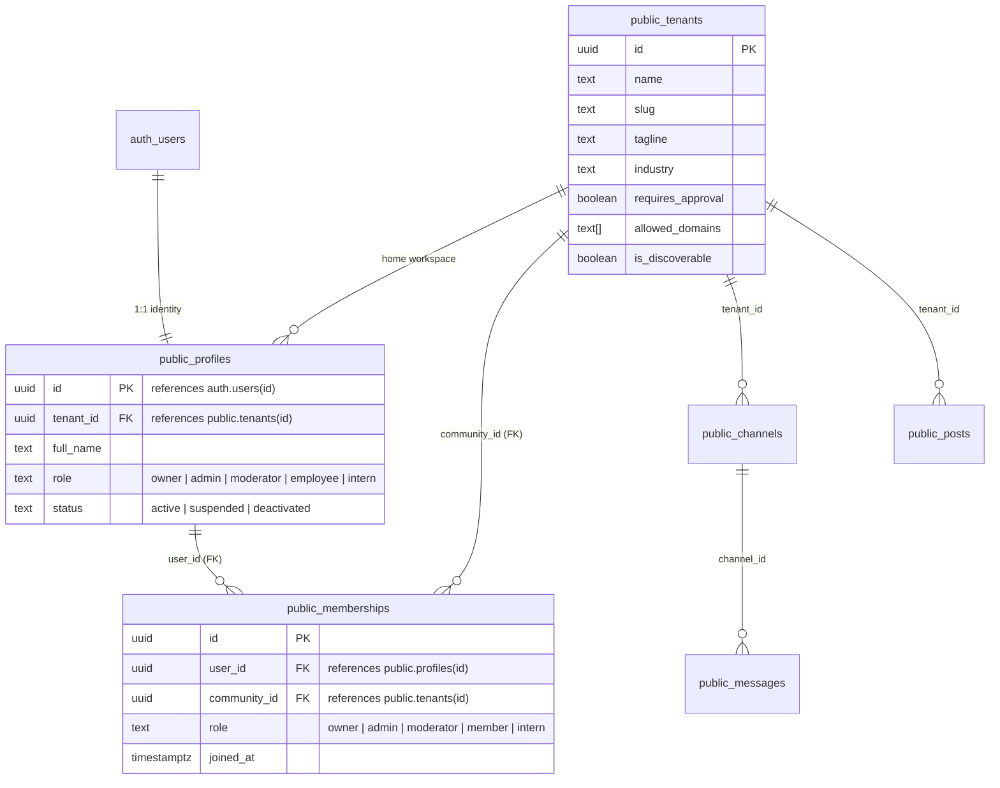
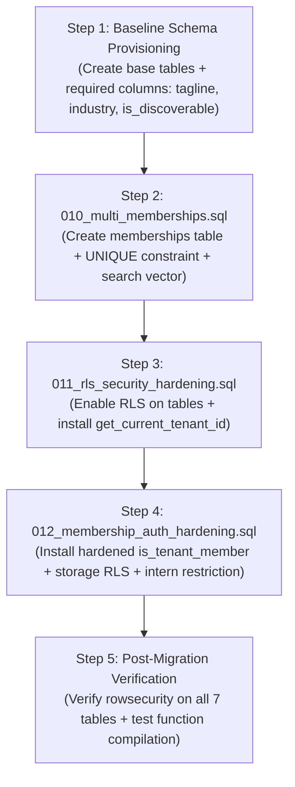

# SYNCLY — SECURITY CYCLE 4.2.1: STAGING DATABASE PREFLIGHT & MIGRATION APPROVAL GATE

**Target Branch:** `security/cycle-3-auth-hardening`  
**Repository:** `Syncly.app`  
**Execution Phase:** Preflight Audit & Dependency Verification (Read-Only)  
**Date:** 2026-11-07  
**Gate Status:** **NO-GO (PENDING STAGING CREDENTIALS & BASELINE SCHEMA ALIGNMENT)**

---

## 1. Staging Project Credential Validation (Phase 1)

In accordance with strict preflight protocol, configuration files and runtime environment were audited without outputting secret values:

| Environment Variable | Status in `.env` | Status in Process Environment | Assessment & Security Boundary |
| :--- | :---: | :---: | :--- |
| `NEXT_PUBLIC_SUPABASE_URL` | Placeholder (`your-project.supabase.co`) | **UNSET** | **MISSING:** Must be configured with dedicated staging project URL. |
| `NEXT_PUBLIC_SUPABASE_ANON_KEY` | Placeholder (`your-anon-key`) | **UNSET** | **MISSING:** Must be configured with staging anon key for user context. |
| `SUPABASE_SERVICE_ROLE_KEY` | Placeholder (`your-service-role-key`) | **UNSET** | **MISSING:** Must be configured for server-side test provisioning only. |

### Security Verifications:
- **Git Hygiene:** Clean. `.env` and `.env.local` are untracked/ignored by `.gitignore`. Zero secrets or credentials have been committed.
- **Service-Role Boundary:** `SUPABASE_SERVICE_ROLE_KEY` is strictly confined to server-side synthetic setup scripts and never bundled or exposed to clients.
- **Production Isolation:** Connection to production is strictly blocked; execution cannot proceed until an isolated staging project URL is supplied.

---

## 2. Existing Database Schema Inventory (Phase 2)

Because the staging Supabase project credentials are unset, remote database introspection against the hosted instance cannot execute. However, static repository AST analysis reveals the required baseline schema state:

### 2.1 Core Target Tables
1. `public.tenants` — Primary tenant partition entity.
2. `public.profiles` — User profile entity (1:1 with `auth.users`).
3. `public.memberships` — Multi-tenant membership join table.
4. `public.channels` — Real-time team communication channels.
5. `public.messages` — Real-time chat messages.
6. `public.posts` — Company update feed posts.
7. `public.post_comments` — Comments on company posts.
8. `public.events` / `public.calendar_events` — Scheduled workspace calendar events.
9. `storage.buckets` & `storage.objects` — File attachment storage (`community-media`).

---

## 3. Membership Schema & Foreign-Key Verification (Phase 3)

A deep audit of `supabase/migrations/010_multi_memberships.sql`, `lib/auth/server.ts`, and API routes was conducted to resolve the exact membership data architecture:

### 3.1 Entity Relationship (ER) Diagram

### 3.2 Exact Architectural Findings:
1. **Foreign Key Target:** `memberships.community_id` references `public.tenants(id) ON DELETE CASCADE`.
2. **Naming Consistency:** The column name is `community_id`.
   - `010_multi_memberships.sql` defines `community_id`.
   - `011_rls_security_hardening.sql` & `012_membership_auth_hardening.sql` query `community_id = p_tenant_id`.
   - `types/database.ts` defines `community_id: string`.
   - `app/api/workspaces/switch/route.ts` queries `.eq('community_id', safeTenantId)`.
   - `lib/auth/server.ts` maps `m.community_id`.
3. **Duplicate Prevention:** Enforced by constraint `UNIQUE(user_id, community_id)`. Duplicate memberships for the same user in the same tenant are impossible.
4. **Status Enforcement:** Membership presence in `public.memberships` establishes association. Global account status (`profile.status === 'active'`) is enforced by `lib/auth/server.ts` before memberships are evaluated.

---

## 4. Migration Dependency Analysis (Phase 4)

| Migration | Required Prerequisite Objects | Dependencies & Risks Identified |
| :--- | :--- | :--- |
| **`010_multi_memberships.sql`** | `public.tenants`, `public.profiles` | **RISK:** Creates generated tsvector column using `tagline` and `industry`. If `public.tenants` lacks these columns, migration fails immediately. Also queries `requires_approval` and `allowed_domains`. |
| **`011_rls_security_hardening.sql`** | `public.tenants`, `public.profiles`, `public.memberships`, `public.channels`, `public.messages`, `public.posts` | **RISK:** Policy on `tenants` references column `is_discoverable`. If missing on `tenants`, migration fails. |
| **`012_membership_auth_hardening.sql`** | Function `is_tenant_member`, tables `memberships`, `posts`, `channels`, `messages`, schema `storage.objects` | **SAFE & IDEMPOTENT:** Wraps storage policies in conditional table checks. Anchors `is_tenant_member` into `auth.uid()`. |

> [!CRITICAL]
> **Blank Database Finding:** Migrations 010, 011, and 012 **CANNOT** initialize a blank database. They are delta migrations. The base tables (`tenants`, `profiles`, `channels`, `posts`, `messages`) with extended columns (`tagline`, `industry`, `requires_approval`, `allowed_domains`, `is_discoverable`) must exist before applying 010–012.

---

## 5. Sequenced Migration Execution Plan (Phase 5)

When staging credentials are supplied and approved, migrations must be executed in this exact sequence:

### Potential Destructive Effects & Exclusions:
- **`999_production_cleanup.sql`:** Contains hardcoded `DELETE FROM` statements. **EXCLUDED.**
- **`src/db/migration.sql`:** Contains fallback to Acme `00000000-...-0001`. **EXCLUDED.**

---

## 6. Backup & Recovery Strategy

1. **Pre-Migration Snapshot:** Before executing any migration on staging, trigger a project database backup via the Supabase dashboard (`Database` -> `Backups`) or dump schema via pg_dump.
2. **Rollback Plan:** If a migration statement fails, rollback transactions immediately (`ROLLBACK;`). Since migrations 010–012 use `DROP POLICY IF EXISTS` and conditional DDL, re-runs are safe once schema prerequisites are satisfied.

---

## 7. Preflight Gate Verdict & Recommendation

### Current Verdict: **NO-GO (HALTED AT PREFLIGHT APPROVAL GATE)**

**Reason:**
1. Staging credentials (`NEXT_PUBLIC_SUPABASE_URL`, `NEXT_PUBLIC_SUPABASE_ANON_KEY`, `SUPABASE_SERVICE_ROLE_KEY`) are missing/unset.
2. Under Phase 1 protocol: *"If any required credential is missing, stop and report it."*
3. Under Phase 5 protocol: *"Wait for explicit approval before applying any staging migration."*

### Actions Required to Proceed:
1. Provide the dedicated staging Supabase project credentials in `.env.local` or environment.
2. Grant explicit approval to apply the sequenced baseline + 010 + 011 + 012 migration plan.

