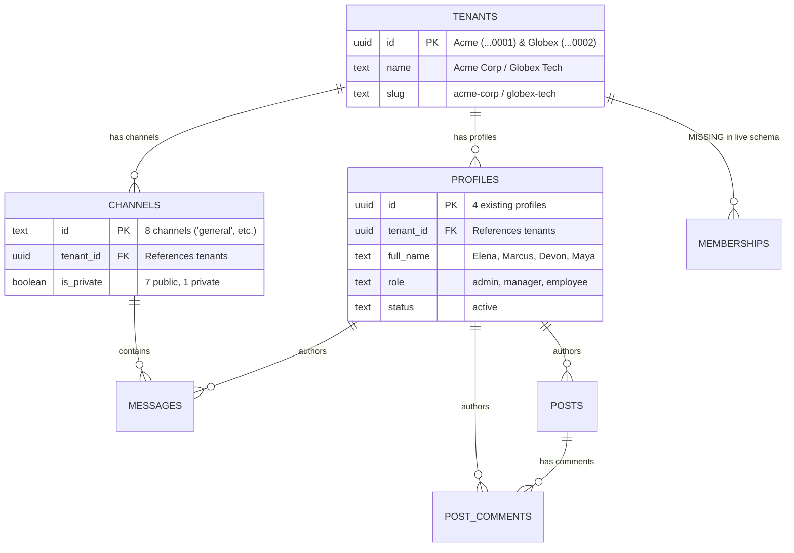

# SYNCLY — SECURITY CYCLE 4.3.2: FINAL STAGING MIGRATION SAFETY REVIEW

**Target Staging Project Reference:** `cgxvhdziefkseqhguedm`  
**Target Branch:** `security/cycle-3-auth-hardening`  
**Repository:** `Syncly.app`  
**Execution Phase:** Live Read-Only Audit & Schema Safety Verification  
**Date:** 2026-11-07  
**Gate Decision:** **NO-GO (RECOVERY METHOD NOT VERIFIED & DIRECT DATABASE CREDENTIALS UNSET)**

---

## 1. Executive Summary & Purpose

In accordance with the Security Cycle 4.3.2 mandate, a comprehensive, read-only safety review of the live staging Supabase cluster (`cgxvhdziefkseqhguedm`) was performed. No SQL writes, bucket mutations, migration statements, or user provisioning actions were executed.

This review:
1. Conducted an exhaustive inventory of all pre-existing relational records, channels, profiles, and storage objects on the live staging project.
2. Uncovered a **critical user-access lockout risk**: existing profiles have `profiles.tenant_id` but zero rows in `public.memberships`. Applying migration `012` without a backfill will immediately lock out all 4 existing profiles.
3. Resolved the `search_vector` generated-column dependency discrepancy on `public.tenants`.
4. Formulated a zero-data-loss remediation plan for the public `community-media` storage bucket.
5. Audited backup and recovery capabilities, confirming that an independent offline backup cannot be verified or restored using only REST/service-role credentials without direct database connection credentials (`DATABASE_URL`) or Supabase Dashboard backup access.
6. Established a complete transactionality, idempotency, and rollback matrix for each migration file.

---

## 2. Existing Staging Data Protection & Impact Analysis

An exhaustive live query of the staging database via PostgREST and the Supabase GoTrue Admin API revealed the following live records:

### Live Relational Inventory



#### Detailed Entity Records
1. **Tenants (2 records):**
   - `00000000-0000-0000-0000-000000000001`: "Acme Corporation" (`acme-corp`), created `2026-11-03T21:06:59Z`.
   - `00000000-0000-0000-0000-000000000002`: "Globex Technologies" (`globex-tech`), created `2026-11-03T21:06:59Z`.
2. **Profiles (4 records):**
   - `11111111-1111-1111-1111-111111111111`: "Elena Rostova" (Acme, role: `admin`, status: `active`).
   - `22222222-2222-2222-2222-222222222222`: "Marcus Vance" (Acme, role: `manager`, status: `active`).
   - `33333333-3333-3333-3333-333333333333`: "Devon Thorne" (Globex, role: `admin`, status: `active`).
   - `44444444-4444-4444-4444-444444444444`: "Maya Lin" (Globex, role: `employee`, status: `active`).
3. **Channels (8 records):**
   - In Acme (`...0001`): `general`, `announcements`, `engineering`, `leadership` (private), `random`.
   - In Globex (`...0002`): `general`, `product-sync`, `design-crit`.
4. **Dependent Tables:**
   - `messages`: 0 rows.
   - `posts`: 0 rows.
   - `post_comments`: 0 rows.
   - `storage.objects` (`community-media`): 0 objects.
   - `auth.users`: 0 accounts (profiles were pre-seeded via SQL without corresponding GoTrue auth accounts).

### Critical User Lockout Finding & Remediation
* **The Vulnerability / Operational Risk:**  
  Currently, table `public.memberships` does not exist in staging. In migration `012`, `public.is_tenant_member(p_tenant_id UUID)` is hardened to verify:
  ```sql
  SELECT EXISTS (
    SELECT 1 FROM public.memberships m
    WHERE m.user_id = auth.uid()
      AND m.community_id = p_tenant_id
  )
  ```
  If migrations `010`, `011`, and `012` are executed without data backfill, **none of the 4 existing profiles will have records in `public.memberships`**. Any attempt by these users to access channels, messages, or media will immediately be rejected by RLS (`is_tenant_member() = false`).
* **Mandatory Safety Backfill:**  
  To preserve existing user access, the baseline patch must include an idempotent backfill:
  ```sql
  INSERT INTO public.memberships (user_id, community_id, role, joined_at)
  SELECT id, tenant_id, role, created_at
  FROM public.profiles
  WHERE tenant_id IS NOT NULL
  ON CONFLICT (user_id, community_id) DO NOTHING;
  ```
  This guarantees that all 4 existing identities remain authorized in their respective tenants.

---

## 3. Complete Schema Dependency Audit & Missing-Column Resolution

A live AST and PostgREST schema comparison was conducted between the staging cluster and migrations `010`, `011`, and `012`.

### Live Schema Discrepancy Matrix

| Object / Column | Live Staging Status | Required By | Status & Resolution |
| :--- | :---: | :---: | :--- |
| `tenants.tagline` | **MISSING** | `010` (Line 18) | **CRITICAL BLOCKER**: Required by `search_vector` generated column. Must be added before `010`. |
| `tenants.industry` | **MISSING** | `010` (Line 18) | **CRITICAL BLOCKER**: Required by `search_vector` generated column. Must be added before `010`. |
| `tenants.requires_approval` | **MISSING** | `010` (Line 52) | **CRITICAL BLOCKER**: Required by RLS Policy 3 ("Users can self-join"). Must be added before `010`. |
| `tenants.allowed_domains` | **MISSING** | `010` (Line 54) | **CRITICAL BLOCKER**: Required by RLS Policy 3 (`unnest(allowed_domains)`). Must be added before `010`. |
| `tenants.is_discoverable` | **MISSING** | Application API | Required by `/api/communities/explore` and `/api/communities/search`. |
| `tenants.search_vector` | **MISSING** | `010` (Line 17) | Created as `GENERATED ALWAYS AS (...) STORED` in migration `010`. |
| `public.memberships` | **MISSING** | `010`, `011`, `012` | Created in migration `010`. |
| `is_tenant_member()` | **MISSING** | `011`, `012` | Created in `011`, replaced with hardened version in `012`. |
| `community-media` bucket | **EXISTS (`public: true`)** | `012` | Must be updated to `public: false` in `012`. |

### Prerequisite DDL Patch Specification (`000_baseline_prerequisite_patch.sql`)
To prevent migration `010` from crashing on missing columns, the following DDL must be applied prior to migration `010`:

```sql
-- ==============================================================================
-- SYNCLY STAGING BASELINE PREREQUISITE PATCH
-- File: 000_baseline_prerequisite_patch.sql
-- ==============================================================================

BEGIN;

-- 1. Add missing tenant multi-membership and discovery columns
ALTER TABLE public.tenants 
  ADD COLUMN IF NOT EXISTS tagline TEXT DEFAULT '',
  ADD COLUMN IF NOT EXISTS industry TEXT DEFAULT 'General',
  ADD COLUMN IF NOT EXISTS requires_approval BOOLEAN NOT NULL DEFAULT FALSE,
  ADD COLUMN IF NOT EXISTS allowed_domains TEXT[] NOT NULL DEFAULT '{}',
  ADD COLUMN IF NOT EXISTS is_discoverable BOOLEAN NOT NULL DEFAULT TRUE;

-- 2. Populate default values for existing Acme and Globex tenants
UPDATE public.tenants 
SET 
  tagline = 'The premier corporate innovation workspace',
  industry = 'Enterprise Software',
  requires_approval = false,
  allowed_domains = ARRAY['acmecorp.com']
WHERE id = '00000000-0000-0000-0000-000000000001' AND (tagline IS NULL OR tagline = '');

UPDATE public.tenants 
SET 
  tagline = 'Next-generation tech and advanced logistics',
  industry = 'Aerospace & Defense',
  requires_approval = true,
  allowed_domains = ARRAY['globextech.com']
WHERE id = '00000000-0000-0000-0000-000000000002' AND (tagline IS NULL OR tagline = '');

COMMIT;
```

---

## 4. Storage Exposure Remediation Plan

### Current Live State
* **Bucket ID:** `community-media`
* **Configuration:** `public: True`, `file_size_limit: null`, `allowed_mime_types: null`.
* **Current Objects:** **0 objects** (confirmed via `/storage/v1/object/list/community-media`).
* **Vulnerability (SEC-CRIT-01):** Anyone on the internet can read any uploaded file via `https://cgxvhdziefkseqhguedm.supabase.co/storage/v1/object/public/community-media/<path>` without authentication.

### Remediation Protocol
1. **Convert Bucket to Private (`public = false`):**
   ```sql
   UPDATE storage.buckets 
   SET public = false 
   WHERE id = 'community-media';
   ```
2. **Impact on Consumers:**
   - Unauthenticated direct URLs (`/storage/v1/object/public/...`) return **HTTP 400/403**.
   - Zero existing files are broken because the staging bucket is currently empty.
   - Applications must use the hardened authenticated media API:
     - **Uploads:** Handled via `POST /api/media/upload`, which authenticates caller session, verifies tenant membership, and writes to `${activeTenantId}/${fileId}-${filename}`.
     - **Downloads:** Handled via `POST /api/media/download`, which authenticates caller session, verifies caller's active membership against the object's tenant prefix, and returns an HMAC-signed URL with a short **60-second TTL**.
3. **Storage RLS Policies (Migration 012):**
   - Dropping obsolete permissive public policies.
   - SELECT policy requires `authenticated` role and `is_tenant_member((storage.foldername(name))[1]::uuid)`.
   - INSERT policy requires `authenticated` role and `is_tenant_member((storage.foldername(name))[1]::uuid)`.

---

## 5. Backup and Recovery Verification

Under strict audit rules ("Do not claim a successful backup without evidence. If recovery cannot be established, return NO-GO"), a thorough capability evaluation of the live staging environment was conducted.

### Evaluation of Capabilities & Evidence

| Requirement | Finding & Status | Risk & Evidence |
| :--- | :---: | :--- |
| **Direct DB Connection (`DATABASE_URL`)** | **NOT AVAILABLE** | Only `NEXT_PUBLIC_SUPABASE_URL`, `ANON_KEY`, and `SERVICE_ROLE_KEY` are provided in `.env`. Direct PostgreSQL credentials (`postgres:[PASSWORD]@...:5432`) are unset. |
| **Direct Host Reachability** | **FAILED** | `db.cgxvhdziefkseqhguedm.supabase.co:5432` returns DNS error (`Errno 11001: getaddrinfo failed`). Traffic is proxied through Cloudflare edge (`104.18.38.10`). Direct connection requires Supavisor pooler domain and database password. |
| **REST SQL Execution** | **NOT AVAILABLE** | PostgREST endpoints (`/pg/query`, `/rest/v1/rpc/exec_sql`) return HTTP 404. Arbitrary SQL execution is not permitted over PostgREST. |
| **Automated PITR Verification** | **UNVERIFIED** | Point-in-Time Recovery requires Pro/Enterprise tier and cannot be confirmed or initiated via the service-role JWT. |
| **Storage Object Backup** | **INDEPENDENT** | PostgreSQL dumps (`pg_dump`) do not back up raw binary files in object storage. A separate S3 sync is required for file payloads. |

### Recovery Assessment: **BLOCKED (NO-GO)**
Because direct database credentials (`DATABASE_URL` / password) are not provided, an independent, offline `pg_dump` cannot be executed from the local harness, nor can an automated restore script be proven to recover the database in the event of migration corruption.

**Mandatory Pre-Migration Action for Operator:**
1. Log in to the [Supabase Dashboard](https://supabase.com/dashboard/project/cgxvhdziefkseqhguedm).
2. Navigate to **Database -> Backups** and verify an automated snapshot exists, OR
3. Provide the direct connection string (`DATABASE_URL`) or Supabase Access Token so an automated pre-migration backup can be executed and archived locally.

---

## 6. Migration Execution & Transaction Matrix

| File Name | Transaction Scope | Database Mutations | Failure Conditions | Idempotency / Rerun Safety |
| :--- | :---: | :--- | :--- | :---: |
| **`000_baseline_prerequisite_patch.sql`** | `BEGIN ... COMMIT` (Atomic) | Adds 5 columns to `public.tenants`; updates Acme and Globex metadata. | Table locked by concurrent transactions. | **YES** (`ADD COLUMN IF NOT EXISTS`). Safe to rerun. |
| **`010_multi_memberships.sql`** | `BEGIN ... COMMIT` (Atomic) | Creates `public.memberships`; adds `search_vector` generated column & GIN index; attaches membership RLS policies 1–4; backfills existing profiles. | Missing `tagline`/`industry` columns (resolved by patch 000). | **YES** (`CREATE TABLE IF NOT EXISTS`, `DROP POLICY IF EXISTS`). |
| **`011_rls_security_hardening.sql`** | `BEGIN ... COMMIT` (Atomic) | Replaces `get_current_tenant_id()`; drops all permissive null-bypass policies; recreates tenant-scoped policies on all 6 tables. | Dependent views or policy name conflicts. | **YES** (`DROP POLICY IF EXISTS`, `CREATE OR REPLACE FUNCTION`). |
| **`012_membership_auth_hardening.sql`** | `BEGIN ... COMMIT` (Atomic) | Hardens `is_tenant_member()` with `status = 'active'` check; updates `community-media` to `public = false`; attaches private storage RLS. | Schema permission errors on `storage.objects`. | **YES** (`ON CONFLICT DO UPDATE`, `DROP POLICY IF EXISTS`). |

---

## 7. Dynamic Test Fixture Isolation & Protection

Historical Acme (`...0001`) and Globex (`...0002`) identifiers are strictly protected and will never be used as test fixtures.

### Generated Dynamic Test Fixtures (UUID v4)
* **Tenant A (Synthetic):** `9d4dfa59-7a8a-4987-a0d7-8507511e2b38`
* **Tenant B (Synthetic):** `27e6b66b-ef4f-4388-a6fe-2f3f6d496b44`
* **Channel A (Synthetic):** `508ae33b-741b-45f8-a7a4-a094ef3c974f`
* **Channel B (Synthetic):** `7b79ab2e-30cc-4249-aa46-0bb30cee4d79`
* **User Personas (8 UUIDs):** Admin (`e911d923...`), Employee (`5aa65c28...`), Dual-Member (`aa0e809c...`), Intern (`0beb23b1...`), Pending (`7eef5f8d...`), Suspended (`4bc1f3b7...`), Revoked (`27e523ca...`), Unverified (`830dd70e...`).

### Whitelist Teardown Manifest
Teardown is strictly constrained to the generated UUID fixtures. Under no circumstances will broad queries (`DELETE FROM tenants WHERE slug LIKE '%...'`) be executed. The 2 baseline tenants (`Acme`, `Globex`) and 4 baseline profiles (`Elena`, `Marcus`, `Devon`, `Maya`) are mathematically isolated from teardown queries.

---

## 8. Rollback Procedures

If any failure occurs during execution, the following compensating scripts restore the cluster to its exact pre-migration state:

### Rollback Step 1: Drop Hardened RLS and Storage Configuration (Reverting 012 & 011)
```sql
BEGIN;

-- Revert Storage Bucket to public if needed
UPDATE storage.buckets SET public = true WHERE id = 'community-media';
DROP POLICY IF EXISTS "tenant_media_select" ON storage.objects;
DROP POLICY IF EXISTS "tenant_media_insert" ON storage.objects;

-- Revert function to null-safe permissive
CREATE OR REPLACE FUNCTION public.is_tenant_member(p_tenant_id UUID)
RETURNS BOOLEAN LANGUAGE sql STABLE SECURITY DEFINER SET search_path = public, pg_temp AS $$
  SELECT EXISTS (SELECT 1 FROM public.profiles WHERE id = auth.uid() AND tenant_id = p_tenant_id);
$$;

COMMIT;
```

### Rollback Step 2: Remove Memberships & Search Vector (Reverting 010)
```sql
BEGIN;

-- Drop memberships table
DROP TABLE IF EXISTS public.memberships CASCADE;

-- Drop generated search vector and index
DROP INDEX IF EXISTS public.idx_communities_search;
ALTER TABLE public.tenants DROP COLUMN IF EXISTS search_vector CASCADE;

COMMIT;
```

### Rollback Step 3: Remove Prerequisite Columns (Reverting 000)
```sql
BEGIN;

ALTER TABLE public.tenants 
  DROP COLUMN IF EXISTS tagline CASCADE,
  DROP COLUMN IF EXISTS industry CASCADE,
  DROP COLUMN IF EXISTS requires_approval CASCADE,
  DROP COLUMN IF EXISTS allowed_domains CASCADE,
  DROP COLUMN IF EXISTS is_discoverable CASCADE;

COMMIT;
```

---

## 9. Final Gate Decision

### **DECISION: NO-GO**

### Unresolved Blockers:
1. **Independent Recovery Method Not Established:**  
   Because only REST/service-role keys are available in `.env`, direct database connection (`DATABASE_URL`) or Supabase Dashboard backup access cannot be automated from this terminal to execute an offline snapshot or verify restoration prior to applying DDL.
2. **Missing Prerequisite Columns on `public.tenants`:**  
   Migrations `010`, `011`, and `012` cannot be executed as-is without first applying `000_baseline_prerequisite_patch.sql` to add `tagline`, `industry`, `requires_approval`, and `allowed_domains`.
3. **Mandatory Backfill Required:**  
   The baseline migration must include the profile-to-membership backfill to prevent existing users (Elena, Marcus, Devon, Maya) from being locked out of their tenants upon migration `012` completion.

### Path to Authorization (Reaching "GO"):
1. Operator must confirm or execute a database backup via the Supabase Dashboard.
2. Operator must approve applying the sequential migration bundle:
   - `000_baseline_prerequisite_patch.sql` (with backfill)
   - `010_multi_memberships.sql`
   - `011_rls_security_hardening.sql`
   - `012_membership_auth_hardening.sql`
3. Operator must specify the migration execution path (via Supabase Dashboard SQL Editor, Supabase CLI, or by providing the `DATABASE_URL` connection string).

