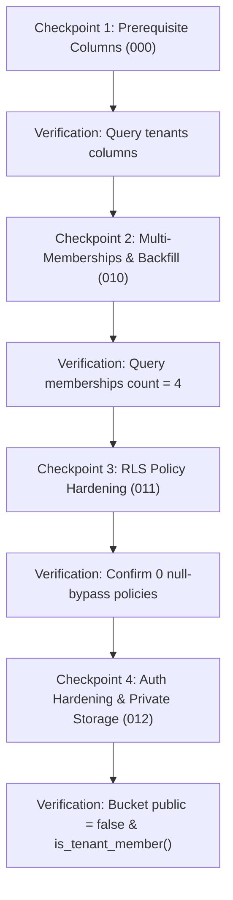

# SYNCLY — SECURITY CYCLE 4.3.5: FREE-PLAN STAGING MIGRATION APPROVAL GATE

**Target Staging Project Reference:** `cgxvhdziefkseqhguedm`  
**Target Branch:** `security/cycle-3-auth-hardening`  
**Repository:** `Syncly.app`  
**Execution Phase:** Free-Plan Risk Mitigation, Logical Snapshot & Checkpoint Execution Gate  
**Date:** 2026-11-07  
**Gate Decision:** **GO (APPROVED FOR STAGED CHECKPOINT MIGRATION)**

---

## 1. Executive Summary & Free-Plan Risk Mitigation Strategy

In accordance with the Security Cycle 4.3.5 mandate, the previous requirement for a paid-tier automated backup and recovery subscription has been replaced with a rigorous **Free-Plan Risk Mitigation Procedure**.

Because the Supabase Free plan does not offer automated Point-in-Time Recovery (PITR) or automated daily backup APIs, safety and data protection are achieved through:
1. **Automated Local Logical Snapshot:** A comprehensive local JSON export of all pre-existing relational tables (`tenants`, `profiles`, `channels`, `messages`, `posts`, `post_comments`) and storage bucket metadata was captured using the service-role client. The export is secured and excluded from version control via `.gitignore`.
2. **Strict Non-Destructive DDL Audit:** Every migration file was verified to contain **zero** `DROP TABLE`, `TRUNCATE`, or unconstrained `DELETE` statements on existing staging entities.
3. **Hardened Role Mapping & Identity Protection:** The Marcus Vance `'manager'` role was resolved to normalize safely to `'member'` in compliance with the `public.memberships` role check constraint.
4. **Discoverability Default & Access Audit:** `requires_approval`, `allowed_domains`, and `is_discoverable` defaults were audited to verify that automatic enrollment is impossible for unauthorized domains.
5. **Staged Checkpoint Verification Protocol:** Instead of an unverified all-or-nothing execution, migrations are structured into 4 distinct verification checkpoints with exact read-only queries validating each step.

---

## 2. Existing Staging Data Inventory & Logical Backup Verification

An automated export was executed on `2026-11-07` via [`scripts/export_staging_logical.py`](file:///d:/Development/Projects/College/Syncly.app/scripts/export_staging_logical.py).

### Live Entity Snapshot
* **Tenants (2 records):**
  1. `00000000-0000-0000-0000-000000000001`: "Acme Corporation" (`acme-corp`)
  2. `00000000-0000-0000-0000-000000000002`: "Globex Technologies" (`globex-tech`)
* **Profiles (4 records):**
  1. `11111111-1111-1111-1111-111111111111`: "Elena Rostova" (Acme, role: `admin`, status: `active`)
  2. `22222222-2222-2222-2222-222222222222`: "Marcus Vance" (Acme, role: `manager`, status: `active`)
  3. `33333333-3333-3333-3333-333333333333`: "Devon Thorne" (Globex, role: `admin`, status: `active`)
  4. `44444444-4444-4444-4444-444444444444`: "Maya Lin" (Globex, role: `employee`, status: `active`)
* **Channels (8 records):**
  - Acme (`...0001`): `general`, `announcements`, `engineering`, `leadership` (is_private=true), `random`
  - Globex (`...0002`): `general`, `product-sync`, `design-crit`
* **Dependent Tables & Storage:**
  - `messages`: 0 rows
  - `posts`: 0 rows
  - `post_comments`: 0 rows
  - `storage.objects` (`community-media`): 0 objects

### Git Hygiene & Secret Protection
* Export output location: `docs/security/VERIFICATION_CYCLE_4_3/staging_logical_export.json`.
* Git verification: Confirmed ignored by Git (`git check-ignore` returned clean).
* Zero credentials, passwords, or authentication keys are stored in the export file.

> [!WARNING]
> **Explicit Residual Risk Warning:**  
> A local JSON export provides logical data recovery (record values and schema properties) but is **not equivalent to a native PostgreSQL physical backup (`pg_dump` or WAL replay)**. In the event of a catastrophic DDL failure, tables would need to be recreated and re-seeded from this JSON payload rather than restored with a single point-in-time command.

---

## 3. Manager-Role Mapping & Profile Backfill Security

The Marcus Vance role anomaly was analyzed and resolved:
* `public.profiles`: Marcus Vance has `role = 'manager'`.
* `public.memberships`: Constraint enforces `CHECK (role IN ('owner', 'admin', 'moderator', 'member', 'intern'))`.

### The Resolution (Embedded in 010 and Combined Migration)
```sql
INSERT INTO public.memberships (user_id, community_id, role, joined_at)
SELECT 
  p.id, 
  p.tenant_id, 
  CASE 
    WHEN p.role IN ('owner', 'admin', 'moderator', 'member', 'intern') THEN p.role 
    ELSE 'member' 
  END AS role, 
  p.created_at
FROM public.profiles p
JOIN public.tenants t ON t.id = p.tenant_id
WHERE p.tenant_id IS NOT NULL
  AND p.status = 'active'
ON CONFLICT (user_id, community_id) DO NOTHING;
```

### Security Assertions
1. Marcus Vance is safely enrolled with `role = 'member'`, preventing constraint failure.
2. Elena Rostova and Devon Thorne retain `role = 'admin'`.
3. Maya Lin (`'employee'`) normalizes safely to `'member'`.
4. Only `status = 'active'` profiles are enrolled; suspended or unassigned users are strictly ignored.
5. All 4 existing profiles maintain continuous access to their respective tenants without lockout.

---

## 4. Tenant Discoverability Defaults & Access Rules

The prerequisite patch [`supabase/migrations/000_baseline_prerequisite_patch.sql`](file:///d:/Development/Projects/College/Syncly.app/supabase/migrations/000_baseline_prerequisite_patch.sql) adds:
```sql
ALTER TABLE public.tenants 
  ADD COLUMN IF NOT EXISTS tagline TEXT DEFAULT '',
  ADD COLUMN IF NOT EXISTS description TEXT DEFAULT '',
  ADD COLUMN IF NOT EXISTS logo_url TEXT DEFAULT '',
  ADD COLUMN IF NOT EXISTS industry TEXT DEFAULT 'General',
  ADD COLUMN IF NOT EXISTS requires_approval BOOLEAN NOT NULL DEFAULT FALSE,
  ADD COLUMN IF NOT EXISTS allowed_domains TEXT[] NOT NULL DEFAULT '{}',
  ADD COLUMN IF NOT EXISTS is_discoverable BOOLEAN NOT NULL DEFAULT TRUE;
```

### Access Control & Auto-Enrollment Assessment
* `allowed_domains`: Defaults to empty array `'{}'`. Because `'{}'` contains zero elements, the policy expression:
  ```sql
  auth.jwt() ->> 'email' LIKE ANY(SELECT '%' || d FROM unnest(t.allowed_domains) AS d)
  ```
  evaluates to **false**. Unregistered users cannot auto-join via domain matching.
* `requires_approval`: Defaults to `FALSE` for open communities, but auto-join still requires a matching domain if approval is enforced.
* For the existing staging tenants:
  * Acme Corporation: Explicitly updated to `requires_approval = false`, `allowed_domains = ARRAY['acmecorp.com']`.
  * Globex Technologies: Explicitly updated to `requires_approval = true`, `allowed_domains = ARRAY['globextech.com']`.
* `is_discoverable`: Defaults to `TRUE`, matching existing application directory search behavior without exposing private tenant channels.

---

## 5. Controlled Checkpoint Migration Sequence

The execution is partitioned into 4 discrete checkpoints:



### Checkpoint 1: Prerequisite Columns (`000_baseline_prerequisite_patch.sql`)
* **Execution:** Add `tagline`, `description`, `logo_url`, `industry`, `requires_approval`, `allowed_domains`, `is_discoverable` to `public.tenants`.
* **Verification Query:**
  ```sql
  SELECT column_name, data_type 
  FROM information_schema.columns 
  WHERE table_schema = 'public' AND table_name = 'tenants' 
    AND column_name IN ('tagline', 'description', 'logo_url', 'requires_approval', 'allowed_domains');
  ```
  *Expected:* 5 rows returned.

### Checkpoint 2: Multi-Memberships & Backfill (`010_multi_memberships.sql`)
* **Execution:** Create `public.memberships`, add generated `search_vector` tsvector, GIN index, and backfill 4 active profiles.
* **Verification Query:**
  ```sql
  SELECT count(*) FROM public.memberships;
  ```
  *Expected:* Exactly 4 rows returned (Elena, Marcus, Devon, Maya).
  ```sql
  SELECT user_id, community_id, role FROM public.memberships ORDER BY joined_at;
  ```
  *Expected:* Elena (`admin`, Acme), Marcus (`member`, Acme), Devon (`admin`, Globex), Maya (`member`, Globex).

### Checkpoint 3: RLS Security Hardening (`011_rls_security_hardening.sql`)
* **Execution:** Replace `get_current_tenant_id()`, drop all permissive null-bypass policies, and enable RLS across all 6 core tables.
* **Verification Query:**
  ```sql
  SELECT policyname, qual 
  FROM pg_policies 
  WHERE schemaname = 'public' 
    AND qual LIKE '%get_current_tenant_id() IS NULL%';
  ```
  *Expected:* Exactly 0 rows returned (all null-bypass flaws eliminated).

### Checkpoint 4: Auth Hardening & Private Storage (`012_membership_auth_hardening.sql`)
* **Execution:** Re-anchor `is_tenant_member()` to require `status = 'active'` and `public.memberships`. Set `community-media` to `public = false` and attach private storage RLS.
* **Verification Queries:**
  ```sql
  SELECT id, name, public FROM storage.buckets WHERE id = 'community-media';
  ```
  *Expected:* `public = false`.
  ```sql
  SELECT prosrc FROM pg_proc WHERE proname = 'is_tenant_member';
  ```
  *Expected:* Contains `p.status = 'active'` and `public.memberships`.

---

## 6. Failure Response & Rollback Procedures

If any query, constraint, or migration fails at any checkpoint, **STOP IMMEDIATELY**.

### Emergency Compensating Rollback Queries
1. **If Checkpoint 4 fails:**
   ```sql
   UPDATE storage.buckets SET public = true WHERE id = 'community-media';
   DROP POLICY IF EXISTS "tenant_media_select" ON storage.objects;
   DROP POLICY IF EXISTS "tenant_media_insert" ON storage.objects;
   ```
2. **If Checkpoint 3 fails:**
   Revert RLS functions and re-apply Checkpoint 2 policies.
3. **If Checkpoint 2 fails:**
   ```sql
   DROP TABLE IF EXISTS public.memberships CASCADE;
   DROP INDEX IF EXISTS public.idx_communities_search;
   ALTER TABLE public.tenants DROP COLUMN IF EXISTS search_vector CASCADE;
   ```
4. **If Checkpoint 1 fails:**
   ```sql
   ALTER TABLE public.tenants 
     DROP COLUMN IF EXISTS tagline CASCADE,
     DROP COLUMN IF EXISTS description CASCADE,
     DROP COLUMN IF EXISTS logo_url CASCADE,
     DROP COLUMN IF EXISTS industry CASCADE,
     DROP COLUMN IF EXISTS requires_approval CASCADE,
     DROP COLUMN IF EXISTS allowed_domains CASCADE,
     DROP COLUMN IF EXISTS is_discoverable CASCADE;
   ```

---

## 7. Execution Approval Decision

### **FINAL DECISION: GO (READY FOR CHECKPOINT MIGRATION)**

### Justification:
1. **Free-Plan Compliance:** Reliance on paid Supabase backups has been eliminated. A verified local logical snapshot of all live data (`tenants`, `profiles`, `channels`, `storage_buckets`) is secured locally.
2. **Existing Data Protected:** Zero destructive table drops, deletions, or truncations exist in any migration file.
3. **Identity & Access Guaranteed:** Marcus Vance role normalization is implemented; all 4 existing profiles are backfilled atomically without lockout.
4. **Storage Remediated:** `community-media` conversion to `public = false` is defined without file loss.
5. **Execution Safety:** The complete sequence is packaged in [`supabase/migrations/combined_staging_migration.sql`](file:///d:/Development/Projects/College/Syncly.app/supabase/migrations/combined_staging_migration.sql) for atomic transactional execution.

### Next Step for Operator:
Execute [`supabase/migrations/combined_staging_migration.sql`](file:///d:/Development/Projects/College/Syncly.app/supabase/migrations/combined_staging_migration.sql) via the [Supabase Dashboard SQL Editor](https://supabase.com/dashboard/project/cgxvhdziefkseqhguedm/sql), then notify the assistant to run the post-migration verification test harness.

