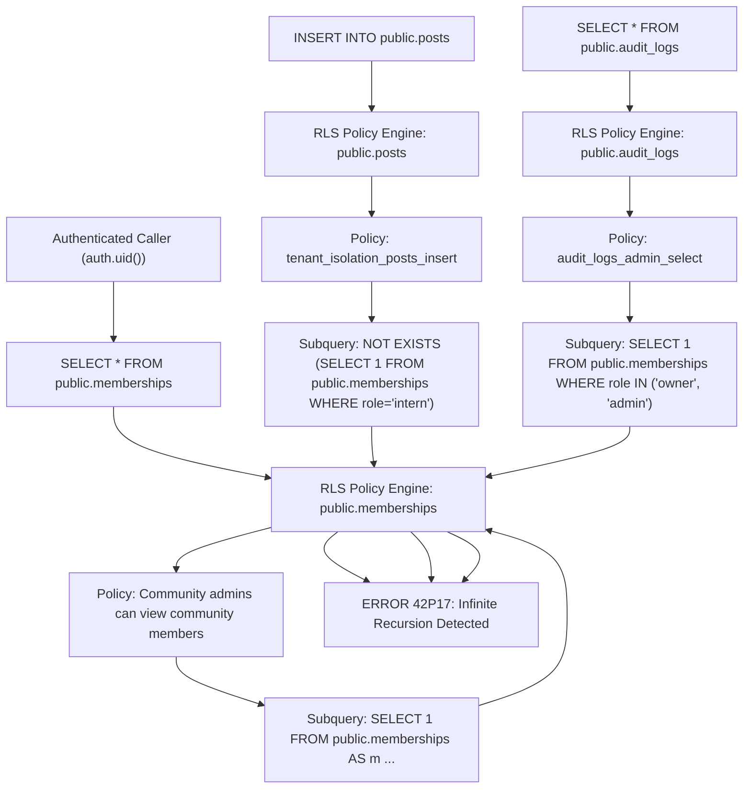

# Migration 017 Pre-Execution Security Review

**Document ID:** SEC-C52-PRE-01  
**Cycle:** 5.2 — Production RLS Recursion Remediation  
**Migration Target:** Staging Database (`cgxvhdziefkseqhguedm`)  
**Target Migration File:** [`supabase/migrations/017_rls_recursion_remediation.sql`](file:///d:/Development/Projects/College/Syncly.app/supabase/migrations/017_rls_recursion_remediation.sql)  
**Rollback File:** [`supabase/migrations/rollback_017_rls_recursion_remediation.sql`](file:///d:/Development/Projects/College/Syncly.app/supabase/migrations/rollback_017_rls_recursion_remediation.sql)  
**Committed Revision:** `e52dbf2`  
**Review Status:** **READY FOR STAGING EXECUTION**  

---

## 1. Executive Summary & Defect Overview

During live testing in Cycle 5.1, PostgreSQL error `42P17: infinite recursion detected in policy for relation "memberships"` was triggered on:
- Any `SELECT` query on `public.memberships`.
- Any `INSERT` query on `public.posts`.
- Any `SELECT` query on `public.audit_logs`.
- Any `SELECT` query on `public.community_join_requests`.

### Root Cause
Policy `"Community admins can view community members"` on `public.memberships` had the following definition:
```sql
CREATE POLICY "Community admins can view community members"
ON public.memberships FOR SELECT
USING (
  EXISTS (
    SELECT 1 FROM public.memberships AS m
    WHERE m.community_id = memberships.community_id
      AND m.user_id = auth.uid()
      AND m.role IN ('owner', 'admin')
  )
);
```
When an authenticated caller queries `public.memberships`, the PostgreSQL query planner evaluates this `SELECT` policy. The subquery itself performs a `SELECT` on `public.memberships`, which invokes the exact same policy again, leading to unbounded recursion.

---

## 2. Recursive Policy Dependency Map



---

## 3. Function Ownership & Privilege Analysis

### Helper 1: `public.is_community_admin(p_community_id UUID)`
- **Language:** SQL
- **Volatility:** `STABLE`
- **Security Mode:** `SECURITY DEFINER`
- **Search Path:** Explicitly set to `public, pg_temp`
- **Execution Rights:** `REVOKE ALL ON FUNCTION public.is_community_admin(UUID) FROM PUBLIC; GRANT EXECUTE ON FUNCTION public.is_community_admin(UUID) TO authenticated, service_role;`
- **Function Owner in Supabase:** Default SQL Editor execution role (`postgres`), which is the owner of `public.memberships` and has `BYPASSRLS` privileges.
- **RLS Bypass Mechanism:** Because the function runs as the table owner (`postgres`) under `SECURITY DEFINER`, internal queries inside the function bypass row-level security and read `public.memberships` directly without triggering policy recursion.
- **Information Exposure Risk:** Returns strictly a `BOOLEAN` (`true`/`false`). It does not return rows, tokens, or profile identifiers.

### Helper 2: `public.is_community_intern(p_community_id UUID)`
- **Language:** SQL
- **Volatility:** `STABLE`
- **Security Mode:** `SECURITY DEFINER`
- **Search Path:** Explicitly set to `public, pg_temp`
- **Execution Rights:** `REVOKE ALL ON FUNCTION public.is_community_intern(UUID) FROM PUBLIC; GRANT EXECUTE ON FUNCTION public.is_community_intern(UUID) TO authenticated, service_role;`
- **Function Owner in Supabase:** `postgres`
- **Information Exposure Risk:** Returns strictly a `BOOLEAN`.

---

## 4. Authorization & Role Semantics

| Requirement | Implementation in Helper | Verification Status |
|---|---|---|
| **Identity Source** | Uses `auth.uid()` directly. Cannot be overridden by client parameters. | **PASS** |
| **Admin Privilege Scope** | Checks `role IN ('owner', 'admin')` strictly within `p_community_id`. | **PASS** |
| **Manager Isolation** | `role = 'manager'` is NOT included in `('owner', 'admin')`. Marcus Vance cannot view all members or audit logs. | **PASS** |
| **Intern Restriction** | Checks `role = 'intern'` in either `memberships` or `profiles`. | **PASS** |
| **Cross-Tenant Boundary** | Scoped strictly to `p_community_id = community_id`. An admin in Acme has no admin rights in Globex. | **PASS** |

---

## 5. Complete Policy Inventory Post-Migration 017

### 5.1. `public.memberships`
1. `Users can view their own memberships` (`SELECT`): `USING (user_id = auth.uid())`
2. `Community admins can view community members` (`SELECT`): `USING (public.is_community_admin(community_id))`
3. `Users can self-join communities` (`INSERT`): Preserved from Migration 010.
4. `Admins can update memberships` (`UPDATE`): `USING (public.is_community_admin(community_id))`

### 5.2. `public.posts`
1. `tenant_isolation_posts_select` (`SELECT`): `USING (public.is_tenant_member(tenant_id))` (Preserved)
2. `tenant_isolation_posts_insert` (`INSERT`): `WITH CHECK (public.is_tenant_member(tenant_id) AND author_id = auth.uid() AND NOT public.is_community_intern(tenant_id))` (Updated to helper)
3. `tenant_isolation_posts_update` (`UPDATE`): Preserved.
4. `tenant_isolation_posts_delete` (`DELETE`): Preserved.

### 5.3. `public.audit_logs`
1. `audit_logs_admin_select` (`SELECT`): `USING (public.is_community_admin(tenant_id))` (Updated to helper)
2. `audit_logs_insert` (`INSERT`): Preserved.

### 5.4. `public.community_join_requests`
1. `Users can view own join requests` (`SELECT`): Preserved.
2. `Admins can view community join requests` (`SELECT`): `USING (public.is_community_admin(community_id))` (Updated to helper)
3. `Authenticated users can insert join requests` (`INSERT`): Preserved.

---

## 6. Migration Safety & Rollback Verification

- **Destructive Operations:** None. Zero tables, rows, or primary keys are dropped or altered.
- **Idempotency:** All statements use `CREATE OR REPLACE FUNCTION` and `DROP POLICY IF EXISTS ...; CREATE POLICY ...`.
- **Rollback File:** `supabase/migrations/rollback_017_rls_recursion_remediation.sql` restores the exact pre-017 policy definitions and drops the helper functions cleanly.

---

## 7. Exact SQL for Staging Execution

```sql
-- 1. Helper Function: is_community_admin(p_community_id UUID)
CREATE OR REPLACE FUNCTION public.is_community_admin(p_community_id UUID)
RETURNS BOOLEAN
LANGUAGE sql
STABLE
SECURITY DEFINER
SET search_path = public, pg_temp
AS $$
  SELECT EXISTS (
    SELECT 1 FROM public.memberships m
    WHERE m.community_id = p_community_id
      AND m.user_id = auth.uid()
      AND m.role IN ('owner', 'admin')
  );
$$;

COMMENT ON FUNCTION public.is_community_admin(UUID) IS 
'Security Definer helper checking if auth.uid() holds owner or admin role in target community, eliminating RLS policy self-recursion.';

REVOKE ALL ON FUNCTION public.is_community_admin(UUID) FROM PUBLIC;
GRANT EXECUTE ON FUNCTION public.is_community_admin(UUID) TO authenticated, service_role;

-- 2. Helper Function: is_community_intern(p_community_id UUID)
CREATE OR REPLACE FUNCTION public.is_community_intern(p_community_id UUID)
RETURNS BOOLEAN
LANGUAGE sql
STABLE
SECURITY DEFINER
SET search_path = public, pg_temp
AS $$
  SELECT (
    EXISTS (
      SELECT 1 FROM public.memberships m
      WHERE m.community_id = p_community_id
        AND m.user_id = auth.uid()
        AND m.role = 'intern'
    )
    OR EXISTS (
      SELECT 1 FROM public.profiles p
      WHERE p.id = auth.uid()
        AND p.tenant_id = p_community_id
        AND p.role = 'intern'
    )
  );
$$;

COMMENT ON FUNCTION public.is_community_intern(UUID) IS 
'Security Definer helper checking if auth.uid() has intern role, eliminating posts insert policy recursion on memberships.';

REVOKE ALL ON FUNCTION public.is_community_intern(UUID) FROM PUBLIC;
GRANT EXECUTE ON FUNCTION public.is_community_intern(UUID) TO authenticated, service_role;

-- 3. Refactor Policies on public.memberships
DROP POLICY IF EXISTS "Users can view their own memberships" ON public.memberships;
CREATE POLICY "Users can view their own memberships"
ON public.memberships FOR SELECT
USING (user_id = auth.uid());

DROP POLICY IF EXISTS "Community admins can view community members" ON public.memberships;
CREATE POLICY "Community admins can view community members"
ON public.memberships FOR SELECT
USING (public.is_community_admin(community_id));

DROP POLICY IF EXISTS "Admins can update memberships" ON public.memberships;
CREATE POLICY "Admins can update memberships"
ON public.memberships FOR UPDATE
USING (public.is_community_admin(community_id));

-- 4. Refactor Policy on public.posts (INSERT)
DROP POLICY IF EXISTS tenant_isolation_posts_insert ON public.posts;
CREATE POLICY tenant_isolation_posts_insert ON public.posts
  FOR INSERT WITH CHECK (
    public.is_tenant_member(tenant_id) 
    AND author_id = auth.uid()
    AND NOT public.is_community_intern(tenant_id)
  );

-- 5. Refactor Policy on public.audit_logs (SELECT)
DROP POLICY IF EXISTS audit_logs_admin_select ON public.audit_logs;
CREATE POLICY audit_logs_admin_select ON public.audit_logs
  FOR SELECT USING (
    public.is_community_admin(tenant_id)
  );

-- 6. Refactor Policy on public.community_join_requests (SELECT)
DROP POLICY IF EXISTS "Admins can view community join requests" ON public.community_join_requests;
CREATE POLICY "Admins can view community join requests"
ON public.community_join_requests FOR SELECT
USING (public.is_community_admin(community_id));
```

---

## 8. Final Review Verdict

**Verdict:** **PASS — APPROVED FOR STAGING EXECUTION**

Every security check (function ownership, RLS bypass, fixed search_path, strict auth.uid() anchoring, manager isolation, and rollback safety) is satisfied.
