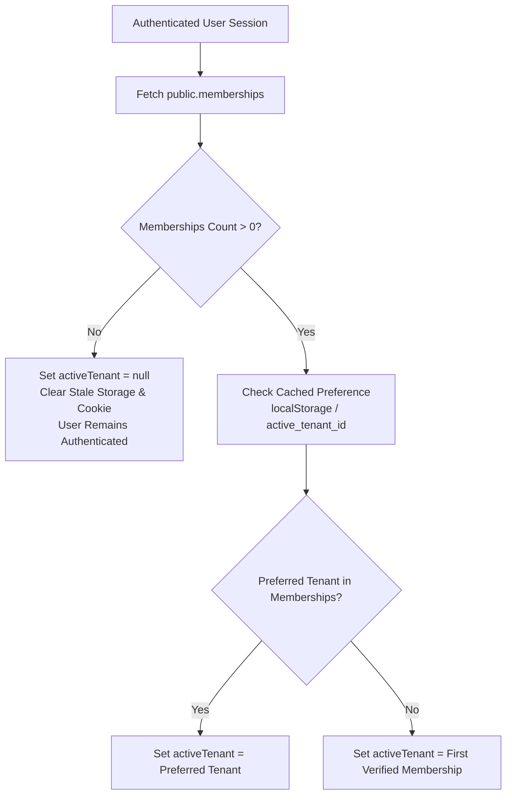

# Cycle 10.3 — AuthContext Remediation Report

## Executive Summary

`lib/context/AuthContext.tsx` is the primary React Context provider orchestrating authenticated user identity and active tenant context on the client. In Cycle 10.3, `fetchProfileAndTenant` was refactored from the ground up to establish strict membership-first resolution.

---

## 1. Refactored Resolution Protocol

The refactored `fetchProfileAndTenant` follows an unambiguous 5-step protocol:



### Exact Code Implementation:

```typescript
// 2. Authoritative Tenant Resolution via memberships ONLY
const { data: memberRecords, error: memErr } = await (supabase.from('memberships') as any)
  .select('community_id, role')
  .eq('user_id', currentUser.id);

if (memErr) {
  console.error('[AuthContext] Failed to query user memberships:', memErr);
}

const verifiedCommunityIds: string[] = (memberRecords || [])
  .map((m: any) => m.community_id)
  .filter(Boolean);

// If the user has NO active memberships, activeTenant MUST be null
if (verifiedCommunityIds.length === 0) {
  setActiveTenant(null);
  clearStaleWorkspaceStorage();
  setLoading(false);
  return;
}

// Check preferred tenant from localStorage / cookie, validate against memberships
const storedPref = typeof window !== 'undefined' ? localStorage.getItem('active_tenant_id') : null;
let targetTenantId: string = verifiedCommunityIds[0];

if (storedPref && verifiedCommunityIds.includes(storedPref)) {
  targetTenantId = storedPref;
} else if (storedPref && !verifiedCommunityIds.includes(storedPref)) {
  clearStaleWorkspaceStorage();
}

// Fetch tenant row for targetTenantId
const { data: tenantData } = await (supabase.from('tenants') as any)
  .select('id, name, slug, logo_url')
  .eq('id', targetTenantId)
  .maybeSingle();
```

---

## 2. Invalidation of Stale Client Storage

When a user has no active memberships or switches to a workspace they are not authorized for, the helper `clearStaleWorkspaceStorage()` ensures all stale state is wiped:
1. `localStorage.removeItem('active_tenant_id')`
2. `document.cookie = 'active_tenant_id=; path=/; max-age=0; SameSite=Lax'`

---

## 3. Server-Side Mirroring (`lib/auth/server.ts`)

`lib/auth/server.ts` was updated to ensure server components and API routes mirror the client behavior:
- If a user has zero memberships, `activeTenantId` is returned as `null` while preserving the authenticated `user` and `profile`.
- Server logic never falls back to `profile.tenant_id` or `user_metadata.tenant_id`.
