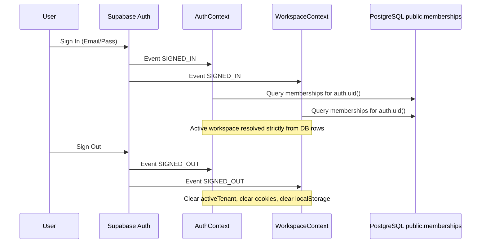

# Cycle 10.3.2 — Authentication Lifecycle & Workspace Revalidation Report

## Executive Summary

To ensure seamless coordination between user authentication and active workspace context, the Supabase Auth listener in `WorkspaceProvider` and `AuthContext` enforces a strict lifecycle synchronization protocol.

---

## 1. Lifecycle Event Handling

---

## 2. Key Safeguards

1. **Session Resiliency**:
   - A transient network failure during `refreshMemberships()` sets `membershipStatus = 'error'` without destroying `supabase.auth.getSession()`.
2. **Revocation Propagation**:
   - If an administrator revokes a user's membership in the database, the next membership revalidation or session refresh detects the removal, resets `activeTenant` to null, and invokes `clearStaleWorkspaceStorage()`.
3. **Logout Completeness**:
   - `SIGNED_OUT` cleanly empties `joinedCommunities`, `allCommunities`, resets `activeCommunity` to `null`, wipes `active_tenant_id` cookies, and removes `syncly_workspace` from `localStorage`.
