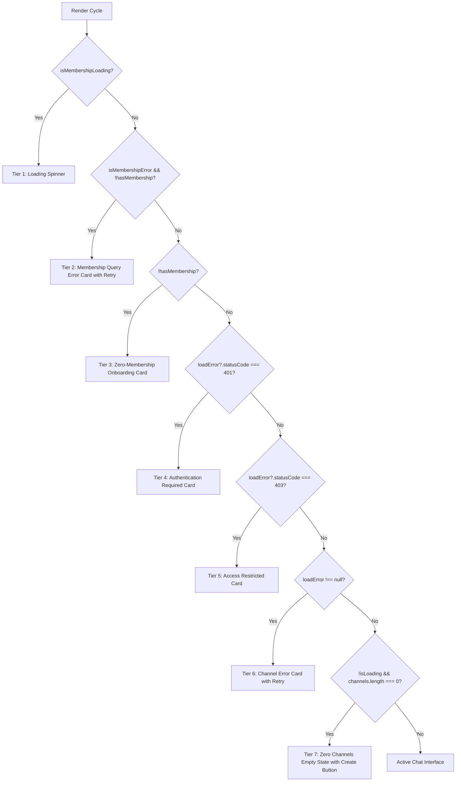

# Cycle 10.3.3 — Membership Error UI & Channel State Hierarchy Report

## Executive Summary

`app/(dashboard)/channels/[channelId]/page.tsx` was vulnerable to race conditions where a loading or failing membership query caused the component to prematurely render the *"You are not currently a member of any workspace"* onboarding view. This falsely told users they had no memberships when in reality a network query was either still resolving or had encountered an error.

Cycle 10.3.3 implements a strict, prioritized 7-tier rendering hierarchy.

---

## 1. Prioritized State Hierarchy

The component now resolves UI states in the following order:

---

## 2. Distinction Between Error and Zero Memberships

- **Error State**: Renders a rose card with an explicit error description and a **Retry Membership Check** button that triggers `retryMembershipFetch()` and `refreshMemberships()`.
- **Zero-Membership State**: Renders an indigo onboarding card explaining that channel messaging requires an organization, with buttons to **Explore Workspaces** and **Create Workspace**.
- Under no circumstances does a database error result in an empty state.
